# Lab 01: Sentiment analysis using traditional machine learning

## Laboratory session

Lab 01, text preprocessing, Bag of Words and machine learning.
I cleaned short review sentences, turned them into word counts, and trained two models to tell positive reviews from negative ones. All the code and outputs are in [Lab01_Sentiment_Analysis.ipynb](notebook/Lab01_Sentiment_Analysis.ipynb).

## Objective

Practise the basic NLP steps on a real dataset: preprocess the text, explore it, build a Bag of Words representation, train a classifier and measure how well it works.

### Dataset

[Sentiment Labelled Sentences](https://archive.ics.uci.edu/dataset/331/sentiment+labelled+sentences) from the UCI Machine Learning Repository. It has 3,000 one-sentence reviews: 1,000 each from Amazon, IMDb and Yelp, each labelled 1 (positive) or 0 (negative), with 500 of each label per source. The three files are in `data/`.

The dataset is licensed under CC BY 4.0. It comes from: D. Kotzias, M. Denil, N. de Freitas and P. Smyth, "From Group to Individual Labels Using Deep Features", KDD 2015.

## Tasks and implementation

### Setup

I used VS Code with a Jupyter notebook on Python 3.14.6. The libraries are pandas, NLTK, scikit-learn, Matplotlib and Seaborn, installed with `%pip` in the first cell. The notebook reads the data from `../data/`, so it has to run from the `notebook` folder, which is what VS Code does by default.

### Task 1: load the dataset

Each file is tab-separated, so I read them with `pd.read_csv(..., sep="\t", names=["review", "sentiment"], quoting=3)` and joined them with `pd.concat()`.

Without `quoting=3`, IMDb loaded only 748 rows (see observation 1).

### Task 2: preprocess the text

All the cleaning goes into a new `clean_text` column, so the original `review` column stays untouched:

- lowercase with `.str.lower()`
- replace everything except letters, digits and spaces with a space, using `re.sub(r"[^a-zA-Z0-9\s]", " ", text)`
- remove extra spaces with `" ".join(text.split())`

The first 10 rows of `review` and `clean_text` are shown side by side to compare them.

### Task 3: explore the text

I showed examples of positive reviews (`sentiment == 1`) and negative reviews (`sentiment == 0`), then counted words with `Counter`, for all reviews and for each label. The top words were the same filler words on both sides, so I removed NLTK's English stopwords and counted again. A Seaborn bar chart shows the top 10 words for each label.

### Task 4: split the dataset

`train_test_split` with `test_size=0.2` and `random_state=42`, so the split is the same every time I run it.

### Task 5: Bag of Words

`CountVectorizer` turns each review into a count of every word in the vocabulary. I fitted it on the training set only and then used it to transform the test set, so words that appear only in the test set don't end up in the vocabulary.

### Task 6: train the models

The lab sheet says "SVM, Logistic Regression etc.", so I trained both: `LogisticRegression(max_iter=1000)` and `LinearSVC()`.

### Task 7: evaluate

Accuracy, precision, recall and F1 from `sklearn.metrics`, for both models. For Logistic Regression I also drew a confusion matrix as a Seaborn heatmap.

### Task 8: test new sentences

A new sentence goes through the same cleaning steps, then `bow_convertor.transform()`, then `model.predict()`. I tested one sentence of my own, then five more, including two with "not".

## Results and evidence

### Data

| Source | Reviews | Positive | Negative |
|---|---:|---:|---:|
| Amazon | 1,000 | 500 | 500 |
| IMDb | 1,000 | 500 | 500 |
| Yelp | 1,000 | 500 | 500 |
| **Total** | **3,000** | **1,500** | **1,500** |

The split gave 2,400 training and 600 test reviews, and the Bag of Words vocabulary has 4,512 words.

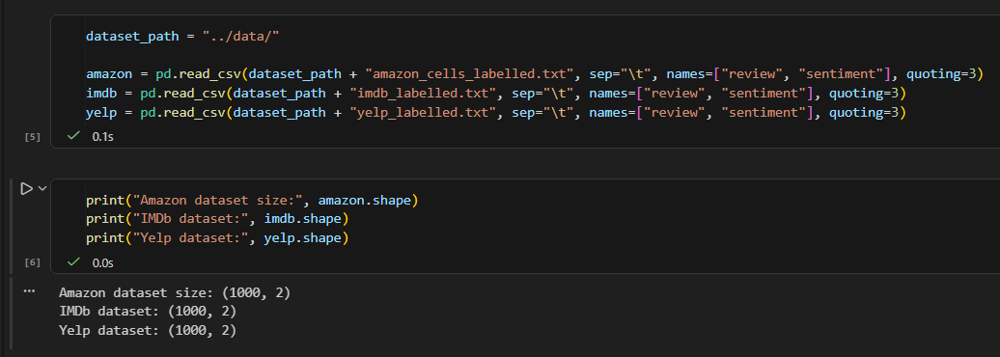

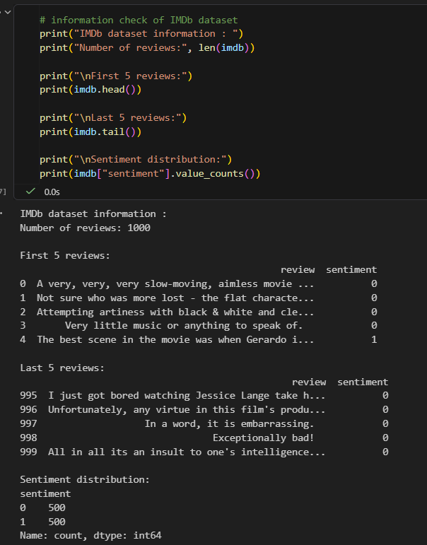

Preprocessing, step by step:

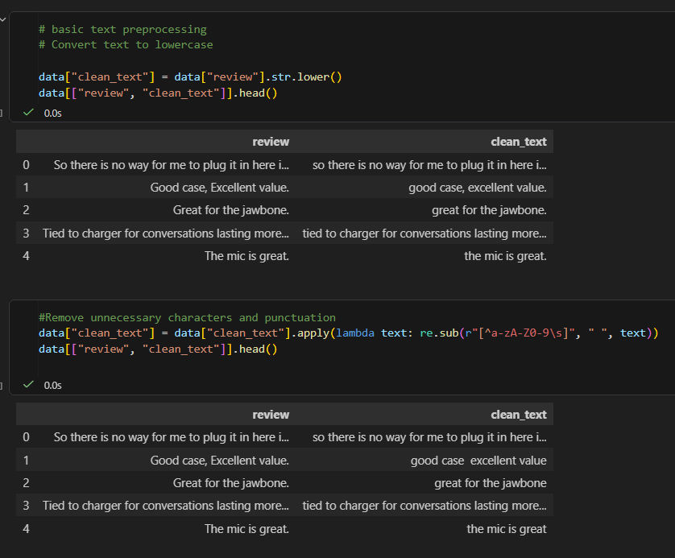

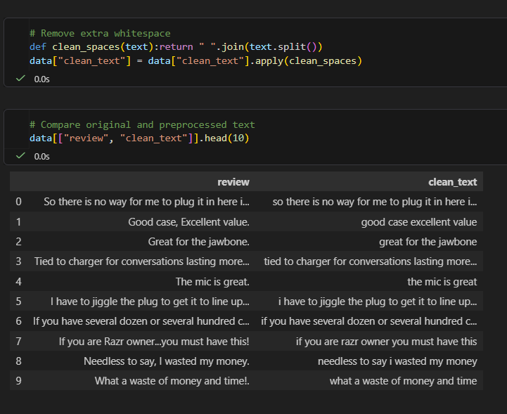

### Exploring the text

Positive and negative examples:

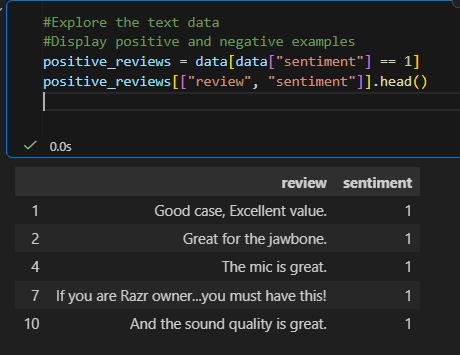

Most common words with stopwords still in. Both lists are almost the same:

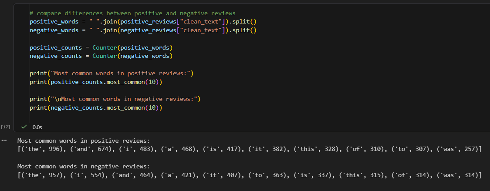

After removing NLTK's stopwords:

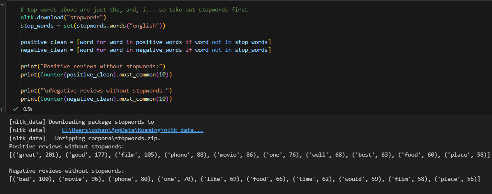

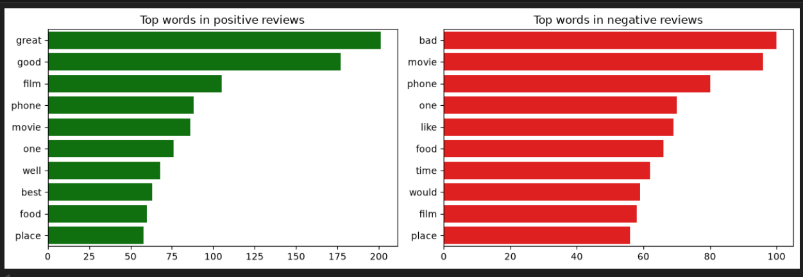

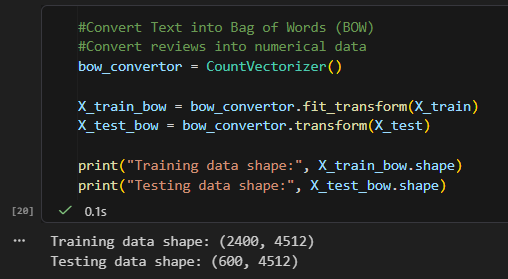

### Model results

| Model | Accuracy | Precision | Recall | F1 |
|---|---:|---:|---:|---:|
| Logistic Regression | 82.33% | 82.61% | 82.06% | 82.33% |
| Linear SVM | 82.00% | 81.43% | 83.06% | 82.24% |

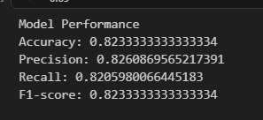

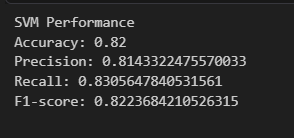

The Logistic Regression confusion matrix: 494 of the 600 test reviews are right. 52 negative reviews were called positive, and 54 positive reviews were called negative.

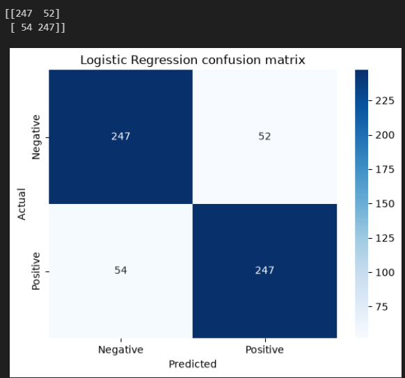

### New sentences

| Sentence | Prediction | Correct? |
|---|---|---|
| I am happy with this product and it is really good | Positive | Yes |
| The food was cold and the service was terrible | Negative | Yes |
| The battery died after two days | Negative | Yes |
| This phone is not good | Negative | Yes |
| This movie was not bad | Negative | No |
| Not bad at all, I would buy it again | Negative | No |

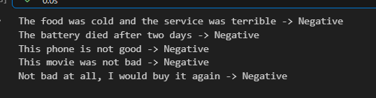

## Observations

1. The IMDb file loaded wrong at first. `read_csv` returned 748 rows, but the file has 1,000 lines. Some reviews contain a `"`, and pandas took it as the start of a quoted field, so it joined many lines into one row. One "review" was 7,944 characters long, with dozens of reviews and their labels inside it. `quoting=3` tells pandas to treat `"` as an ordinary character, and then all 1,000 rows loaded with 500 of each label. Before the fix, with 2,748 rows (some of them broken), accuracy was 82.18%. After the fix, with all 3,000 reviews, it was 82.33%.
2. Counting words without removing stopwords showed nothing useful. The top 10 words for positive and negative reviews were nearly the same list: the, and, i, a, it, is.
3. After removing stopwords, the positive side had clear sentiment words: great (201), good (177), well and best. The negative side had only one, bad (100). The rest, like movie, phone, food and place, appear on both sides, because they describe what is being reviewed, not how the reviewer felt.
4. NLTK's stopword list includes "not" and "no". Negative reviews often use them, so removing stopwords for the word counts hid part of what makes a review negative. The models still saw these words, because `CountVectorizer` keeps all words by default.
5. Logistic Regression and the SVM scored almost the same. The SVM found a few more positive reviews (higher recall) but also called more negative reviews positive (lower precision). With 600 test reviews, the 0.33-point gap in accuracy is 2 reviews, so I wouldn't call either model better.
6. The model can't handle "not bad". It called "This movie was not bad" and "Not bad at all, I would buy it again" negative. Bag of Words counts words and ignores their order, so "not bad" is just "not" plus "bad", and both words mostly appear in negative reviews. "This phone is not good" was right, but for the same reason: "not" pushed it towards negative.
7. "The battery died after two days" was predicted negative although it has no word like "bad" or "terrible". The model learned from the training data that words like "died" lean negative.

## Learning outcomes

- I can load tab-separated text files with pandas and check that the row counts and labels are what I expect. The IMDb bug showed me to compare the loaded count with the file before training anything.
- I can clean text with lowercase, a regular expression and whitespace removal, and keep the original next to the cleaned version.
- I can explore text with word counts, and I learned that stopwords have to be removed before the counts say anything about sentiment.
- I understand Bag of Words: each review becomes a vector of word counts, and the vectorizer is fitted on training data only.
- I can train Logistic Regression and an SVM with scikit-learn and compare them with accuracy, precision, recall, F1 and a confusion matrix.
- Testing my own sentences showed the main limit of Bag of Words: it ignores word order, so negation like "not bad" goes wrong.
