# Lab 02: AI in everyday challenges

## Laboratory session

Lab 02, using an LLM as a product-development partner.
The lab sheet gives eight everyday student problems. I did this lab on my own and took **Group 1, The Forgetful Student**: students rush between lectures, labs and other activities and forget things like their ID card, charger, USB drive, books or water bottle. I used Microsoft Copilot as my partner for the whole design, one prompt per step in the same chat. The product I ended up with is **PackSync**, a timetable app that works with small Bluetooth tags.

- The finished product (concept, name, features, target user, mock-up and presentation script): [activity-outcomes.md](activity-outcomes.md)
- Every prompt, what Copilot answered and what I kept or changed: [llm-process.md](llm-process.md)

## Objective

Apply an LLM to a problem students really have, and use it as a product-development partner to come up with a product concept, a name, key features, a target user and a visual prototype or mock-up. Then explain the problem, the product, the process and how the LLM was used in a 2–3 minute presentation.

## Tasks and implementation

### Step 1: understand the problem

My first prompt gave Copilot a role ("Act as my product-development partner"), described the problem in two sentences and asked for 6 short reasons why it happens. It gave: rushing between classes, distractions, poor organisation, routines that change from day to day, memory overload, and assuming everything is already packed.

### Step 2: generate ideas

I asked for 5 product ideas, some apps, some physical products and some both, each with how it works and one problem with it. Asking for a problem with each idea made the answers easier to compare. It gave:

| Idea | Type | Problem it gave |
|---|---|---|
| SmartPack | App with a checklist for each lecture or lab | Students may ignore the notifications |
| SmartBag | Backpack with sensors and lights in each pocket | Cost and charging |
| LeaveCheck | Device by the door where you tap your ID or phone | Only works if you use it |
| ClassMate | App that reads your timetable and reminds you what to bring | The timetable has to be kept up to date |
| PackSense | Bluetooth tags with an app that alerts you if a tagged item is missing | Tagging books and bottles gets expensive |

Copilot picked PackSense. I didn't take its pick on its own. PackSense only knows about the items that have tags; it has no idea what I need on a particular day. ClassMate knows what each class needs, but it can't tell if I left something behind. Each one covers the other's gap, so I decided to combine ideas 4 and 5.

### Step 3: combine, name and list features

I described the combined product (the app reads my timetable, tags go only on the items I lose most, and it warns me when I walk away from a room without one) and asked for 5 names and 6 key features.

- Names: ClassGuard, PackSync, Don'tLeave, ClassTag and TakeMate. Its favourite was PackSync, and I agreed with it: it's the only name that covers both halves, packing and syncing with the timetable.
- Features: timetable integration, a packing checklist for each class, Bluetooth tags, leave-behind alerts, the last place an item was seen, and a morning readiness check.
- It also pointed out that a Bluetooth tag can't tell which room it's in. It only knows when the item is out of range. So the app has to use the timetable, the phone's location and the last Bluetooth connection together.

### Step 4: target user

Copilot described a third-year Data Science undergraduate with lectures in the morning and computer labs in the afternoon, who leaves their ID card in a lab, the charger at home or the USB drive on a desk. I kept this persona, because it matches my own timetable.

### Step 5: risks

I asked for the 3 biggest risks and a fix for each one:

| Risk | Fix |
|---|---|
| Bluetooth gives false alarms or misses items | Bluetooth Low Energy tags, an adjustable alert distance, and a short delay before the alert |
| Students ignore the notifications | Only remind about the items today's classes need, and put the ID card and charger first |
| Tags cost money and need batteries | Start with a pack of 2–3 tags with replaceable batteries |

It said Bluetooth reliability is the one to solve first, because a few wrong alerts would make students stop trusting the app. All three fixes went into the design. I chose a 30-second delay and a starter pack of 3 tags.

### Step 6: my own feature

I added one feature the LLM didn't suggest: **smart notices**. When a lecturer posts a notice like "bring a calculator to Friday's quiz", an LLM inside the app reads it and adds the calculator to Friday's checklist. I wanted AI to be part of the product too, not only the tool I used to design it.

### Step 7: visual mock-up

The mock-up is in two parts:

1. **Product photo**, generated by Copilot from a prompt describing the phone, the app and the three tags.
2. **App screens**, made with Claude (another LLM) from my final feature list. It built three phone screens as a web page, which was saved as an image: today's checklist, a leave-behind alert and the tags page.

The two parts are separate because generated images often get small text on a screen wrong, and the app screens need to show the features clearly.

### Step 8: presentation

A 2–3 minute script that covers the problem, the product, how I developed it and how I used the LLM. It's at the end of [activity-outcomes.md](activity-outcomes.md#presentation-script).

## Results and evidence

| Required output | Result |
|---|---|
| Product concept | An app that reads your timetable and builds each day's packing list, plus small Bluetooth tags on the ID card, charger and USB drive that warn you when you walk away without them |
| Name | PackSync |
| Key features | Timetable sync, a checklist for each class, Bluetooth tags, leave-behind alerts, last-seen location, a morning readiness check and smart notices |
| Target user | A third-year Data Science undergraduate who moves between lectures, labs, the library and the cafeteria |
| Visual mock-up | A product photo (Copilot) and three app screens (Claude) |

### The problem

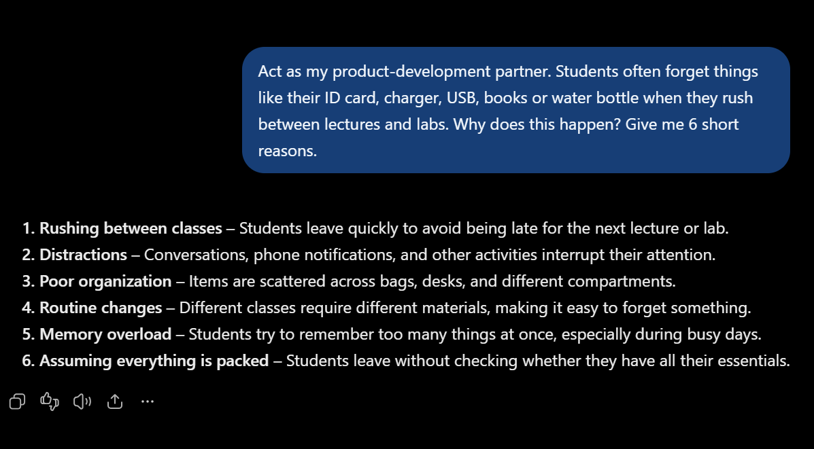

### Five product ideas

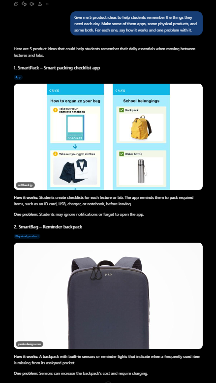

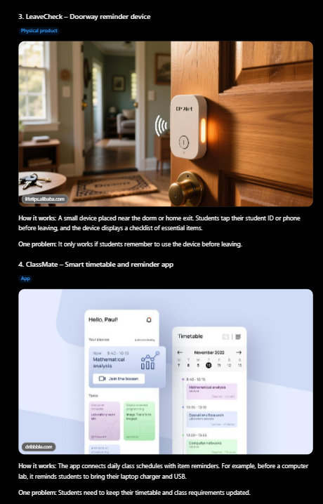

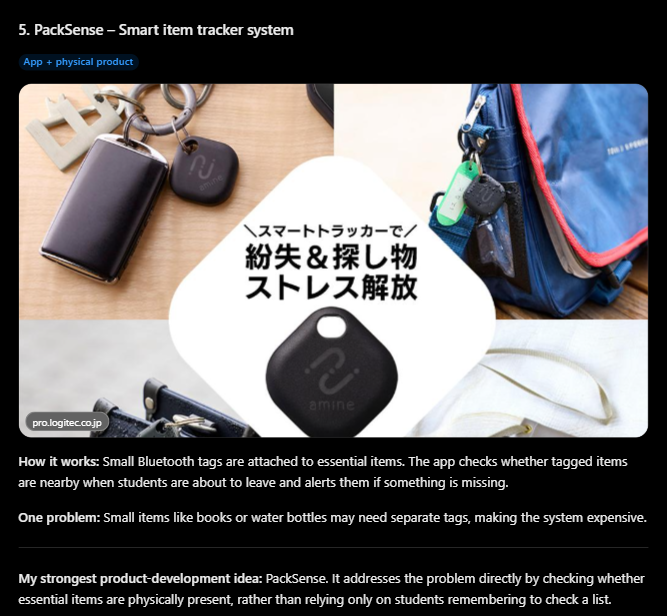

### Names and features

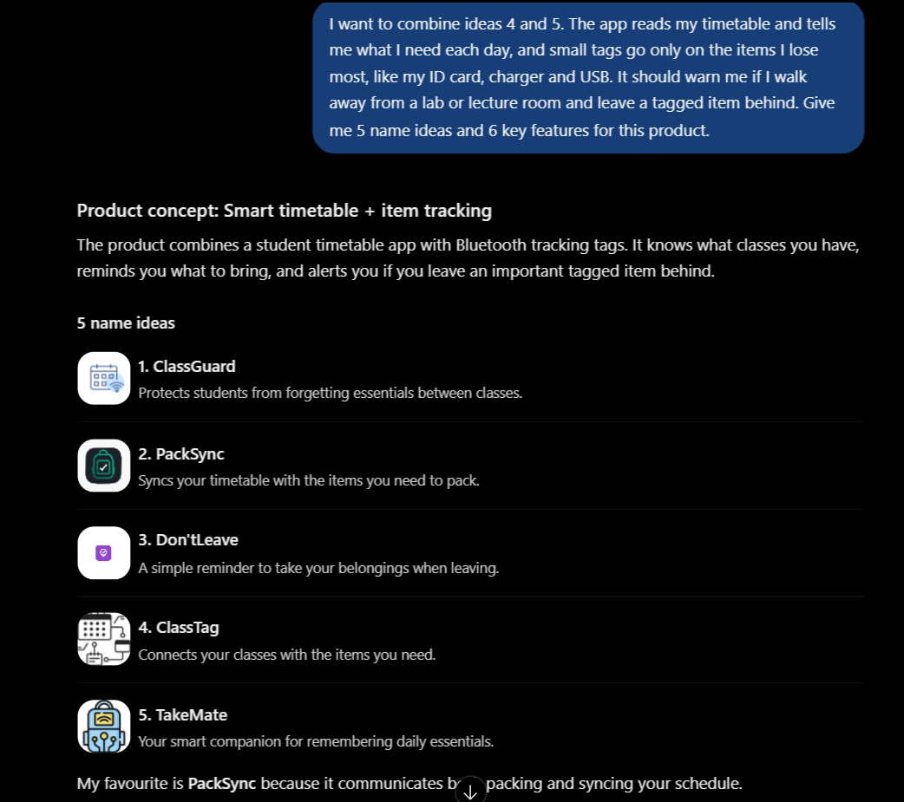

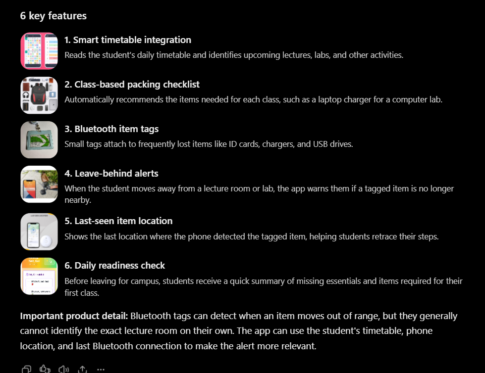

### Target user and risks

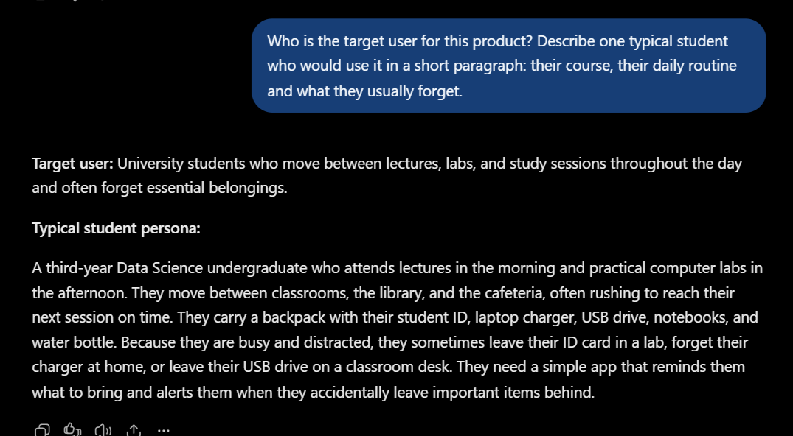

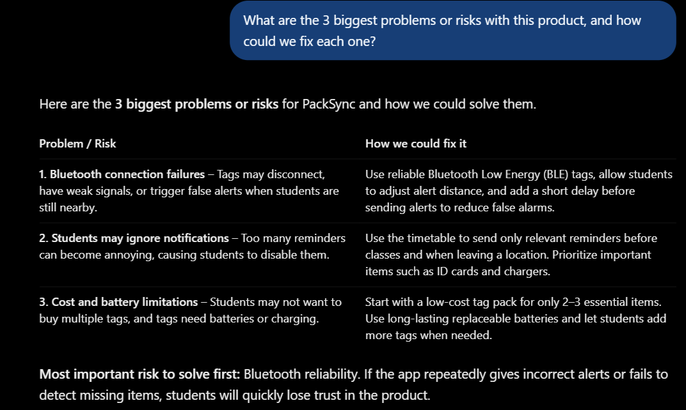

### Mock-up

The prompt and the image Copilot generated:

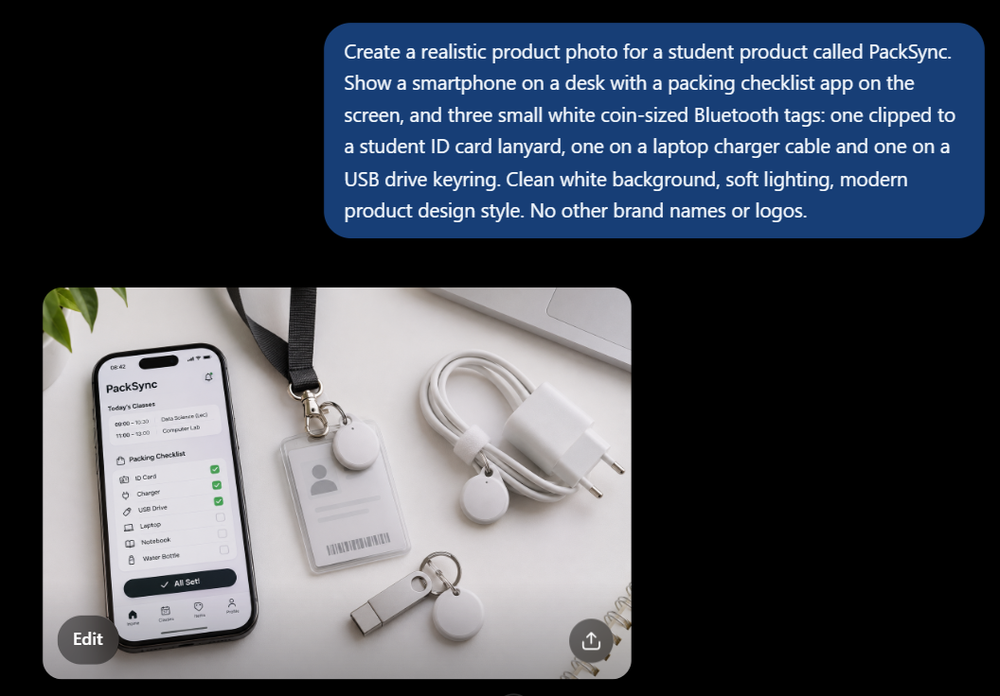

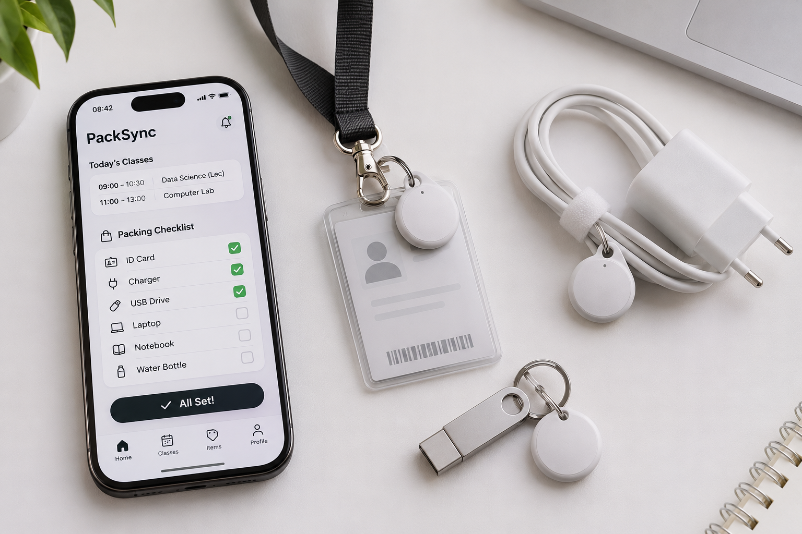

The app screens:

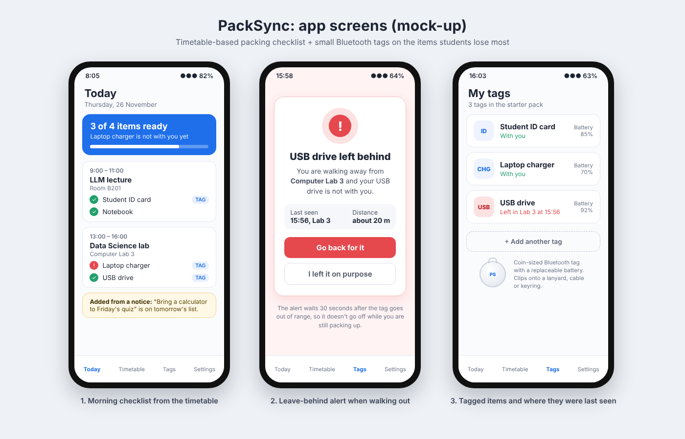

## Observations

1. Copilot was quick at giving options: 6 reasons, 5 ideas and 5 names, each in a few seconds. Choosing between them was still up to me. Its own pick, PackSense, would have reminded me about tagged items but not about what each class needs.
2. Its first answers were general and could apply to any student. Once I described a specific product in prompt 3, the answers got specific too, for example the warning that a tag can't tell which room it's in. The more detail I gave, the more useful the answer.
3. Because all the prompts were in one chat, Copilot remembered the product. In prompts 4 and 5 I only had to write "this product" and it answered about PackSync.
4. The risks prompt was the most useful one, because it changed the design: the 30-second delay in the alert, reminders only for today's classes, and the 3-tag starter pack all came from it.
5. In prompt 2 Copilot showed pictures from the web next to the ideas, from sites such as softbank.jp, yankodesign.com, alibaba.com, dribbble.com and logitec.co.jp, and in prompt 3 it put small pictures next to the names and features. They are other people's products and designs, so I didn't use any of them as my mock-up.
6. The product photo followed most of the prompt: a phone with a PackSync checklist and three white round tags on an ID card holder, a charger cable and a USB drive keyring. The text on the phone is readable and even shows a Data Science lecture and a computer lab. It also has mistakes. The button says "All Set!" while the laptop, notebook and water bottle are still unticked, the charger has a two-pin European plug and not the three-pin plug we use in Sri Lanka, and it added a plant and a laptop even though I asked for a clean white background. A generated image looks finished, but it still has to be checked before it's used as a prototype.

## Learning outcomes

- I can use an LLM through each stage of designing a product: understanding the problem, coming up with ideas, choosing one, naming it, listing features, describing the user, finding the risks and making a mock-up.
- I learned to write prompts with a role, the context and a limit on the answer (6 reasons, 5 ideas, 3 risks), so the answers stay short and easy to compare.
- Asking for a problem with every idea, and then for the biggest risks, made the LLM criticise its own ideas, which helped me choose and improve the design.
- The LLM gives options and points out limits, but the decisions are mine: I combined two ideas instead of taking its pick and added a feature of my own.
- I can use image generation for a quick prototype, and I learned to check what it produces, because it can look right and still be wrong in the details.
- I can explain a product, the process behind it and the role of the LLM in a 2–3 minute presentation.
