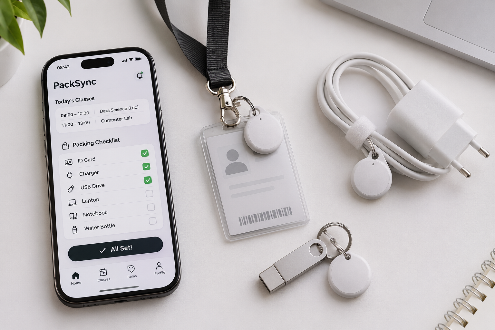
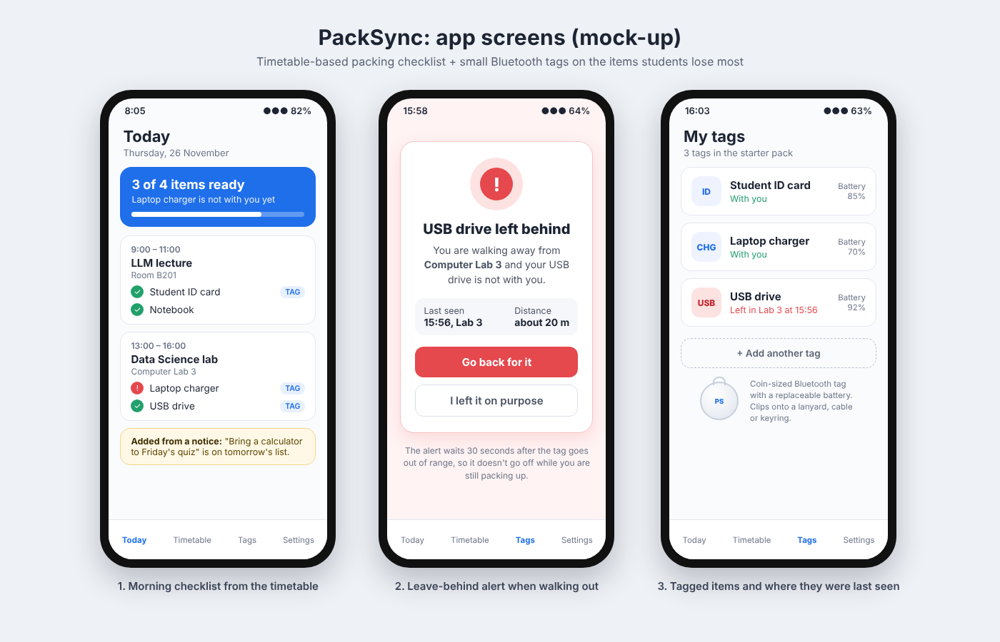

# PackSync: activity outcomes

Group 1, The Forgetful Student, done on my own. This file has the five things the lab sheet asks for and the presentation script. How each part came out of the LLM is in [llm-process.md](llm-process.md).

## Product concept

Students forget things for two reasons: each day needs different items, and things get left behind when you leave a room in a hurry. PackSync deals with both.

It's a phone app with three small Bluetooth tags. The app reads your timetable and makes a packing checklist for the day, so on a lab day it reminds you about your charger and USB drive. The tags go only on the things students lose most: the student ID card, the laptop charger and the USB drive. If you walk away from a lecture room or lab and one of them stays behind, your phone warns you and shows where it was last seen.

## Name

**PackSync.** Copilot suggested five names: ClassGuard, PackSync, Don'tLeave, ClassTag and TakeMate. PackSync is the only one that covers both halves of the product, packing your bag and syncing with your timetable. ClassGuard sounds like a security product, Don'tLeave sounds like a warning, ClassTag only describes the tags and TakeMate could be anything.

## Key features

1. **Timetable sync.** The app reads the student's timetable and knows which lectures and labs are on each day.
2. **A checklist for each class.** Each class has its own items, like a charger and USB drive for a computer lab. The checklists add up to one list for the day.
3. **Bluetooth tags.** Coin-sized tags with replaceable batteries that clip onto a lanyard, a cable or a keyring. It comes as a starter pack of 3.
4. **Leave-behind alerts.** When you move away from a room and a tagged item doesn't come with you, the phone warns you. The alert waits 30 seconds and the distance can be changed, so it doesn't go off while you're still packing up.
5. **Last-seen location.** For each tag the app shows the room and time it was last with you, worked out from the timetable, the phone's location and the last Bluetooth connection, because a tag on its own can't tell which room it's in.
6. **Morning check.** Before you leave for campus, the app shows what's still missing for today's classes.
7. **Smart notices** (my own addition). When a lecturer posts a notice like "bring a calculator to Friday's quiz", an LLM in the app reads it and adds the calculator to Friday's checklist.

Reminders only cover the items today's classes need, with the ID card and charger first, so students don't get so many notifications that they turn them off.

## Target user

University students who move between lectures, labs and study spaces all day. The typical user is a third-year Data Science undergraduate with lectures in the morning and computer labs in the afternoon. They go between classrooms, the library and the cafeteria, often in a rush, with a backpack holding their student ID, laptop charger, USB drive, notebooks and water bottle. They sometimes leave the ID card in a lab, forget the charger at home or leave the USB drive on a desk.

## Risks and how PackSync deals with them

| Risk | How PackSync deals with it |
|---|---|
| Bluetooth gives false alarms or misses an item | Bluetooth Low Energy tags, a 30-second delay before an alert, and an alert distance the student can change |
| Too many notifications, so students ignore them | Reminders only for the items today's classes need, with the ID card and charger first |
| Tags cost money and need batteries | A starter pack of 3 tags with replaceable batteries; more tags can be added later |

## Visual mock-up

### Product photo

Generated by Copilot: the app on a phone, with tags on an ID card holder, a charger cable and a USB drive keyring.

### App screens

Made with Claude from the feature list above.

1. **Today.** The morning checklist built from the timetable. A 9:00 LLM lecture in room B201 needs the ID card and a notebook; a 13:00 Data Science lab in Computer Lab 3 needs the charger and USB drive. The charger is missing, so it shows "3 of 4 items ready". At the bottom, a smart notice has added a calculator to Friday's list.
2. **Leave-behind alert.** At 15:58 the student walks out of Computer Lab 3 without the USB drive. The alert shows where it was last seen, how far away it is, and two buttons: go back for it, or say it was left on purpose.
3. **My tags.** The three tags in the starter pack with their battery levels. The ID card and charger are with the student; the USB drive is marked as left in Lab 3 at 15:56. There is also a drawing of the coin-sized tag.

## Presentation script

About 2 and a half minutes read out at a normal pace.

> Hi, I'm Oshani, and I did Group 1, the forgetful student.
>
> Everyone here has probably done this. You get to a computer lab and your charger is at home, or you walk out and leave your USB drive in the PC. I asked an LLM why this happens, and two of its reasons stood out: we rush between classes, and we leave without checking because we assume everything is packed. Both happen at the moment you walk out of a room.
>
> My product is called PackSync. It's an app plus three small Bluetooth tags. The app reads your timetable, so on a lab day it knows you need your charger and USB, and in the morning it tells you what's missing. The tags go on the three things students lose most: the ID card, the charger and the USB drive. If you walk away from a lab and one of them stays behind, your phone warns you and shows where it was last seen. I also added smart notices: if a lecturer posts "bring a calculator to Friday's quiz", the AI reads it and adds the calculator to Friday's list.
>
> I used Microsoft Copilot as my product-development partner, one step at a time. First I asked why students forget things, then for five product ideas. Copilot liked the tag idea best, but tags alone don't know what you need today, and a timetable app can't tell if you left something behind, so I combined the two. Then I asked for names, features, a target user and the biggest risks.
>
> The risks answer changed the design the most. To stop false alarms, the alert waits 30 seconds. To stop students ignoring it, it only reminds you about today's classes. And to keep the cost down, it starts with a pack of three tags. For the visuals, Copilot made the product photo, and I made the app screens with Claude.
>
> What I learned is that the LLM gives you lots of options fast, but it doesn't decide for you. The photo it made says "All Set!" while half the checklist isn't ticked, so I had to check everything and make the final choices myself.
>
> That's PackSync. Thank you.
