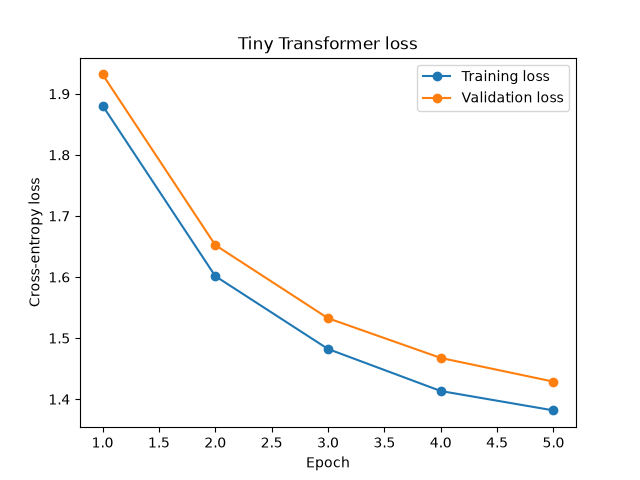

# Lab 03: Developing a tiny Transformer language model

## Laboratory session

Lab 03, Transformer language models.
I built a small character-level Transformer in PyTorch from its parts, trained it to predict the next character of children's stories, and used it to write new stories. All the code and outputs are in [Lab03_Tiny_Transformer.ipynb](notebooks/Lab03_Tiny_Transformer.ipynb). The files it saves are in [results](results).

## Objective

Write each part of a decoder-only Transformer myself, train it for next-character prediction, measure it with validation loss and perplexity, see how the number of layers and attention heads changes the results, and save the model so it can be used again.

### Dataset

[roneneldan/TinyStories](https://huggingface.co/datasets/roneneldan/TinyStories) on Hugging Face: 2,119,719 training stories and 21,990 validation stories. The stories were generated by GPT-3.5 and GPT-4 using a small vocabulary, so a very small model can learn from them. The dataset comes from "TinyStories: How Small Can Language Models Be and Still Speak Coherent English?" (R. Eldan and Y. Li, 2023) and is licensed under CDLA-Sharing-1.0.

## Tasks and implementation

### Setup

VS Code with a Jupyter notebook on Python 3.14.6, PyTorch 2.15.0 on the CPU, plus `datasets`, Matplotlib and pandas. The notebook saves its files to `../results`, so it runs from the `notebooks` folder, which VS Code does by default.

### Task 1: load and explore the dataset

`load_dataset("roneneldan/TinyStories")`, then three stories printed in full. For the first 1,000 stories I measured the length in characters and words, counted how they start and how many have dialogue, and drew a histogram of the lengths.

### Task 2: preprocess the text

I used the first 2,000 stories, joined with blank lines, which gives about 1.7 million characters. That is plenty for a model this size and still trains in minutes on a CPU.

Some stories contain broken characters: curly quotes and apostrophes saved with the wrong encoding, so `’` appears as `’`. I kept plain ASCII characters only, so these don't become tokens of their own.

The tokenizer works at character level. Every different character gets a number (`char_to_int`), and `encode()` and `decode()` convert text to numbers and back.

### Task 3: prepare the training data

The encoded text goes into one PyTorch tensor, with the first 90% for training and the last 10% for validation. `get_batch()` takes 32 random windows of 64 characters (`batch_size = 32`, `block_size = 64`). The target for each window is the same text moved one character to the right, so every position in a window is a training example for "what comes next".

### Task 4: build the Transformer

Each part the lab sheet lists is written out as its own class:

| Class | What it does |
|---|---|
| `Head` | One masked self-attention head. Each position makes a query, a key and a value. Query × key, scaled by 1/√head_size, gives how much to look at each earlier position. A lower-triangle mask (`tril`) sets future positions to −∞ before softmax, so the model can't see the characters it has to predict. |
| `MultiHeadAttention` | Several heads side by side. Their outputs are joined and mixed by a linear layer. |
| `FeedForward` | Linear (64 → 256), ReLU, linear (256 → 64), applied to each position on its own. |
| `Block` | Layer norm → attention → add the input back (residual connection), then layer norm → feed-forward → add the input back. |
| `TinyTransformer` | Token embedding + position embedding, a stack of blocks, a final layer norm, and a linear layer that gives a score for each of the 72 characters. |

Dropout of 0.1 is used after the attention weights, the attention output and the feed-forward layer.

### Task 5: initialise the model

`n_embd = 64`, `n_head = 4`, `n_layer = 2`, `learning_rate = 1e-3`, giving 113,096 parameters. The loss function is `nn.CrossEntropyLoss` and the optimiser is AdamW. Before training I checked the loss against ln(vocab size), which is what a model that guesses at random should score.

### Task 6: train the model

Each step takes a batch, predicts the next character at every position, works out the cross-entropy loss, runs `loss.backward()` (backpropagation) and `optimizer.step()`. One epoch is 748 steps, enough batches to go through the training text about once (1,532,412 ÷ (32 × 64)). I trained for 5 epochs.

### Task 7: monitor training

After each epoch, `estimate_loss()` measures the training and validation loss, each averaged over 50 batches. They are stored in `history` and plotted. The plot is saved as `results/loss_curve.png`.

### Task 8: evaluate the model

The final losses are averaged over 200 batches. Perplexity is e to the power of the validation loss.

### Task 9: generate stories

`generate()` starts from a prompt and adds one character at a time. It crops the text to the last 64 characters (there are only 64 position embeddings), turns the scores for the next character into probabilities with softmax, divided by a temperature, and samples one character. I generated from "Once upon a time" at temperatures 0.5, 0.8 and 1.0.

### Task 10: experiment with model settings

Five settings, each trained from scratch for 1 epoch with the same seed and text: 1, 2 and 4 layers with 4 heads, and 1, 4 and 8 heads with 2 layers. The effect of more epochs is already in the Task 7 loss curve. The table is saved as `results/experiments.csv`.

### Task 11: save the model

`torch.save(model.state_dict(), ...)` saves the weights. The config file saves the settings and the list of 72 characters, which is needed to turn the model's output numbers back into text. I loaded both into a new model and checked it writes exactly the same text as the original with the same seed.

## Results and evidence

### Data

| Measure (first 1,000 stories) | Value |
|---|---:|
| Average length | 942 characters, 184 words |
| Shortest / longest | 274 / 4,123 characters |
| Start with "Once upon a time" | 539 |
| Start with "One day" | 41 |
| Contain dialogue in quotes | 531 |

| Training text | Value |
|---|---:|
| Stories used | 2,000 |
| Broken characters removed | 2,237 (8 different characters) |
| Characters after cleaning | 1,702,681 |
| Vocabulary | 72 characters (80 before cleaning) |
| Training / validation characters | 1,532,412 / 170,269 |

### Training

Loss before training: 4.51, close to ln(72) = 4.28.

| Epoch | Training loss | Validation loss |
|---:|---:|---:|
| 1 | 1.881 | 1.932 |
| 2 | 1.602 | 1.652 |
| 3 | 1.482 | 1.533 |
| 4 | 1.413 | 1.468 |
| 5 | 1.382 | 1.429 |

Training took 415 seconds on the CPU.

### Evaluation

| Measure | Value |
|---|---:|
| Training loss | 1.377 |
| Validation loss | 1.421 |
| Perplexity | 4.14 |

A perplexity of 4.14 means the model is about as unsure as choosing between 4 equally likely characters, out of 72.

### Generated text

From "Once upon a time" at temperature 0.8 ([sample_story.txt](results/sample_story.txt)):

> Once upon a time was in the park.
>
> The was very save that was not to her worried whing the special down. All the bea. He familing to staror next his and stoon, the lack up. Once a time, there was a small other.
>
> Tom didn't want to the storther each and excited ond the bround to play with her and sharted.

At temperature 0.5: "Once upon a time the in the park. The was very save the boy and was and so girl was so happy for down and sure of the the big boy careful the show…"

At temperature 1.0: "Once upon a time little girl smile up up. It was saves that that ove there on it, we walked so feer down. All the man. Roved courful not worth the little girl toy…"

### Experiments (1 epoch each)

| Layers | Heads | Parameters | Validation loss | Perplexity | Time |
|---:|---:|---:|---:|---:|---:|
| 1 | 4 | 63,304 | 1.998 | 7.37 | 41 s |
| 2 | 4 | 113,096 | 1.929 | 6.89 | 75 s |
| 4 | 4 | 212,680 | 1.824 | 6.19 | 136 s |
| 2 | 1 | 113,096 | 1.889 | 6.61 | 33 s |
| 2 | 8 | 113,096 | 1.985 | 7.28 | 84 s |

The 4-layer model's text: "Once upon a time lit in she pick. The caromy thes ves that the wo pled saided ech tood thers sfe rads." The text from every setting is in [experiments.csv](results/experiments.csv).

### Saved model

[tiny_transformer.pth](results/tiny_transformer.pth) (606 KB) and [tiny_transformer_config.json](results/tiny_transformer_config.json). The reloaded model printed "Same text as the original model: True".

## Discussion: mechanisms that improve performance

The lab sheet asks which mechanisms improve performance. These are the ones in my model, and what each one does:

- **Masked self-attention** lets every character use information from any earlier character in the window. The mask also means one window of 64 characters gives 64 training examples at once, without the model seeing the answers.
- **Multiple heads** let the model look for several patterns at the same time, for example one head following the current word and another the start of the sentence.
- **Scaling by 1/√head_size** keeps the attention scores from getting so large that softmax puts all the weight on one position, which would stop the gradients from flowing.
- **Position embeddings** give the model the order of the characters. Attention on its own treats its input as a set.
- **Residual connections** add each layer's input to its output, so gradients reach the early layers directly. This is what makes stacking more layers work, and in my experiment 4 layers scored best.
- **Layer normalisation** before each sub-layer keeps the numbers within a similar range at every layer, so training stays stable with a fairly high learning rate (1e-3).
- **Feed-forward layers** do further processing at each position after attention has gathered information from the others.
- **Dropout (0.1)** randomly switches off parts of the network during training, so the model can't just memorise the training text. My validation loss stayed within about 0.05 of the training loss for all 5 epochs.
- **AdamW** adapts the step size for each parameter and adds weight decay, so training converges faster than plain gradient descent.
- **Outside the model:** more and cleaner data (2,000 stories instead of 200, and no broken characters), and averaging the loss over many batches so I could trust the numbers. At generation time, **temperature** trades safe, repetitive text against varied text with more mistakes.

Bigger language models also use subword tokenizers instead of single characters, much longer context windows, and learning-rate schedules. I didn't use these here.

## Observations

1. My first version of this lab used PyTorch's ready-made `nn.TransformerEncoderLayer` on 200 stories for 500 steps. Its validation loss was 2.01 (perplexity 7.44), measured on a single batch. That layer's default feed-forward width is 2,048 for a 64-wide model, so it had about 575,000 parameters (a 2.3 MB file). Writing the parts myself gave 113,096 parameters, and with 2,000 stories and 5 epochs it reached a validation loss of 1.42 (perplexity 4.14). The two runs used different data and training lengths, so this isn't a fair test of the layer itself, but the second model is smaller and better.
2. 2,237 broken characters (8 different ones, like â, € and ™) appeared in only 2,000 stories. Without cleaning they took up 8 of 80 vocabulary slots.
3. Before training the loss was 4.51, close to ln(72) = 4.28, which confirms the model starts out guessing at random.
4. Both losses fell every epoch, and validation stayed about 0.05 above training. The model wasn't overfitting, and it was still improving at epoch 5, so more epochs would help.
5. The model learned the look of the stories: common words, capital letters after full stops, paragraph breaks, names like Tom, "didn't", and story openings. More than half of the stories start with "Once upon a time" (539 of 1,000), and the model writes "Once a time, there was a small other" in the middle of a story, because the training stories are joined one after another.
6. It didn't learn grammar or meaning ("The was very save that was not to her worried…"). It only sees 64 characters, about 12 words, it works letter by letter, and it trained for about 3,700 steps.
7. Temperature changed the text the way I expected. 0.5 repeated common words ("the the big boy"), and 1.0 made up words ("feer", "courful", "magh").
8. More layers lowered the loss after 1 epoch (1.998 → 1.929 → 1.824 for 1, 2 and 4 layers) but cost time (41 s → 136 s) and parameters (63,304 → 212,680).
9. More heads made it worse here: 1 head scored 1.889 and 8 heads 1.985, with the same number of parameters. The 64 embedding numbers are split between the heads, so 8 heads have only 8 numbers each. One epoch is short, and this could change with longer training. The single head was also the fastest, because my heads run one after another in a Python loop.
10. Training on the CPU was slow: 415 seconds for 5 epochs, with the laptop on battery.

## Learning outcomes

- I can build a decoder-only Transformer from its parts in PyTorch: embeddings, masked multi-head self-attention, feed-forward layers, residual connections and layer normalisation.
- I understand how next-token training data is made: the target is the input shifted by one, and the causal mask turns one window into many examples.
- I can train with cross-entropy loss, backpropagation and AdamW, track training and validation loss per epoch, and read the curves for overfitting.
- I can use perplexity to describe how unsure a language model is.
- I can generate text by sampling, and I saw how temperature changes it.
- Changing layers and heads showed me the trade-off between model size, training time and loss.
- I learned that a saved model also needs its tokenizer (here, the character list) to be useful again.
