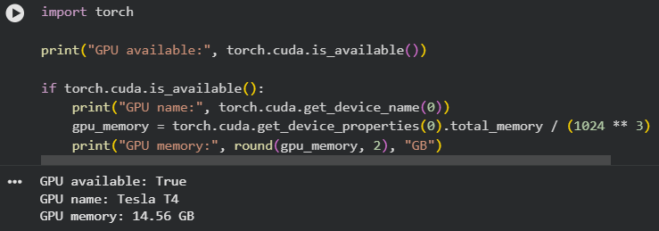
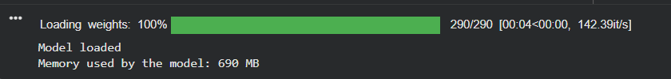
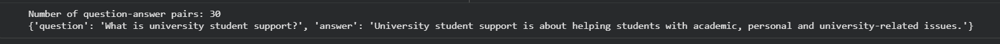
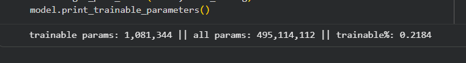
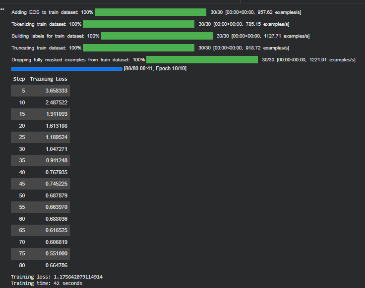
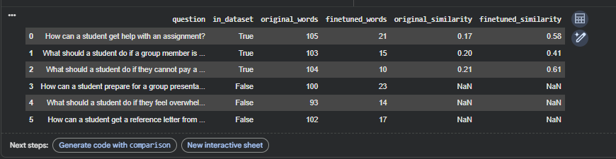
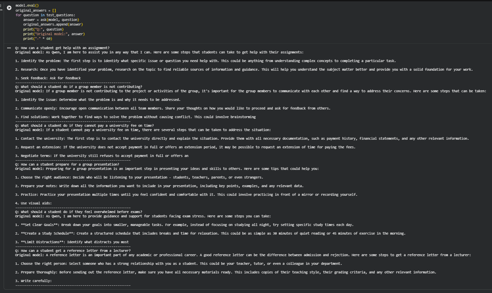
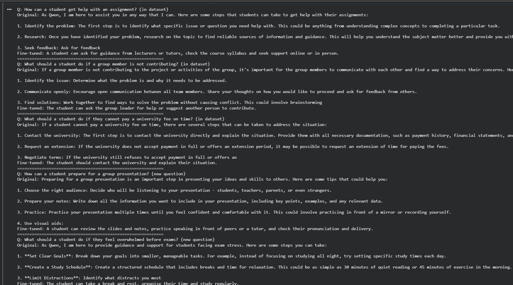
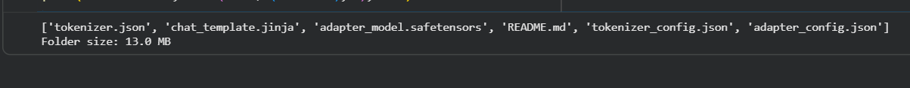

# Lab 04: Fine-tuning an LLM using LoRA/QLoRA

## Laboratory session

Lab 04, parameter-efficient fine-tuning.
I fine-tuned Qwen2.5-0.5B-Instruct on 30 question-and-answer pairs I wrote about university student support. I used QLoRA (a 4-bit model with small LoRA adapters) and TRL's `SFTTrainer` on a Google Colab T4 GPU, then asked the original and the fine-tuned model the same six questions. The code and outputs are in [Lab04_Fine_Tuning.ipynb](notebooks/Lab04_Fine_Tuning.ipynb).

## Objective

Adapt a small instruction-tuned model to one domain by training only a tiny part of it, and see what changes in its answers, both for questions it was trained on and for new ones.

## Tasks and implementation

### Setup

Google Colab with a T4 GPU (**Runtime → Change runtime type → T4 GPU**, then **Runtime → Run all**). The notebook doesn't run on my laptop, because 4-bit loading with `bitsandbytes` needs an NVIDIA GPU.

### Task 1: install the libraries

`transformers`, `datasets`, `peft`, `trl`, `accelerate` and `bitsandbytes`, in one `pip install` line.

### Task 2: check the GPU

`torch.cuda` reports a **Tesla T4 with 14.56 GB** of memory.

A GPU helps because training an LLM is mostly matrix multiplication over millions of numbers. A GPU's thousands of cores do these in parallel, so each training step takes a fraction of the time it would on a CPU. Its memory also has to hold the model, the activations and the gradients, so the model has to be small enough to fit.

### Task 3: choose the model

The sheet suggests Qwen/Qwen2.5-0.5B-Instruct or HuggingFaceTB/SmolLM2-360M-Instruct. I chose **Qwen2.5-0.5B-Instruct** because it is small (about 0.5 billion parameters), already instruction-tuned, has a chat template, and fits easily on a T4 in 4-bit.

It is loaded once, with `BitsAndBytesConfig`: 4-bit NF4 weights, double quantisation, and float16 for calculations, because the T4 has no bfloat16. The parts that are not quantised are loaded in float32 (see observation 2). The loaded model takes **690 MB** of GPU memory.

A small `ask()` function puts a question into the chat template, generates up to 120 new tokens with greedy decoding (`do_sample=False`, so the same question always gets the same answer) and decodes only the new tokens.

### Task 4: create the dataset

30 question-and-answer pairs I wrote about university student support: assignments, exams, plagiarism, group work, counselling, fees, careers and so on. `Dataset.from_list()` turns them into a Hugging Face dataset. Each pair is then put through `tokenizer.apply_chat_template()` as a user message and an assistant reply, so the training text is in the same format the model sees when I ask it a question.

### Task 5: configure LoRA with PEFT (QLoRA)

`prepare_model_for_kbit_training()` gets the 4-bit model ready for training, and turns on gradient checkpointing to save memory. `LoraConfig` adds adapters with rank `r=8`, `lora_alpha=16` and `lora_dropout=0.05` to the attention layers (`q_proj`, `k_proj`, `v_proj`, `o_proj`), and `get_peft_model()` attaches them **once**.

The original weights stay frozen. Only **1,081,344 of 495,114,112 parameters (0.22%)** are trained.

### Task 6: fine-tune with SFTTrainer

`SFTTrainer` with an `SFTConfig`: 10 epochs, batch size 4 (80 steps in total), learning rate 2e-4 and the loss logged every 5 steps. 30 examples need several passes, and LoRA can use a higher learning rate than full fine-tuning. The logged losses are printed and plotted.

### Tasks 7 and 8: test both models with the same questions

The sheet lists this task twice. The same six questions go to both models:

- 3 that are in my dataset: getting help with an assignment, a group member who isn't contributing, and not being able to pay a fee on time.
- 3 that are **not** in my dataset: preparing for a group presentation, feeling overwhelmed before exams, and getting a reference letter from a lecturer.

The original model's answers are recorded **before** LoRA is added, from the same 4-bit model, so the only difference afterwards is the fine-tuning. For each answer I counted the words. For the three dataset questions I also measured how close the answer is to my dataset answer, using `difflib.SequenceMatcher` (0 = nothing in common, 1 = identical).

### Saving the adapter

`model.save_pretrained()` saves only the LoRA adapter, not the whole model. The folder is 13.0 MB, with the tokenizer files. The adapter itself is about 4 MB: 1,081,344 numbers at 4 bytes each.

## Results and evidence

### GPU and model

### Training

80 steps in 42 seconds. The average training loss was 1.176.

| Step | Loss | Step | Loss |
|---:|---:|---:|---:|
| 5 | 3.658 | 45 | 0.745 |
| 10 | 2.488 | 50 | 0.688 |
| 15 | 1.911 | 55 | 0.664 |
| 20 | 1.613 | 60 | 0.688 |
| 25 | 1.190 | 65 | 0.617 |
| 30 | 1.047 | 70 | 0.607 |
| 35 | 0.911 | 75 | 0.551 |
| 40 | 0.768 | 80 | 0.665 |

### Original vs fine-tuned

| Question | In dataset | Original words | Fine-tuned words | Original similarity | Fine-tuned similarity |
|---|---|---:|---:|---:|---:|
| How can a student get help with an assignment? | Yes | 105 | 21 | 0.17 | 0.58 |
| What should a student do if a group member is not contributing? | Yes | 103 | 15 | 0.20 | 0.41 |
| What should a student do if they cannot pay a university fee on time? | Yes | 104 | 10 | 0.21 | 0.61 |
| How can a student prepare for a group presentation? | No | 100 | 23 | | |
| What should a student do if they feel overwhelmed before exams? | No | 93 | 14 | | |
| How can a student get a reference letter from a lecturer? | No | 102 | 17 | | |

Two examples:

**How can a student get help with an assignment?** (in the dataset)

- My dataset answer: "A student can ask the lecturer for guidance, attend tutorials or contact the university academic support service."
- Original model: "As Qwen, I am here to assist you in any way that I can. Here are some steps that students can take to get help with their assignments: 1. Identify the problem… 2. Research… 3. Seek feedback…"
- Fine-tuned model: "A student can ask for guidance from lecturers or tutors, check the course syllabus and seek support online or in person."

**How can a student prepare for a group presentation?** (new question)

- Original model: "Preparing for a group presentation is an important step in presenting your ideas and skills to others. Here are some tips that could help you: 1. Choose the right audience… 2. Prepare your notes… 3. Practice… 4. Use visual aids…"
- Fine-tuned model: "A student can review the slides and notes, practice speaking in front of peers or a tutor, and check their pronunciation and delivery."

The original model's answers to all six questions:

Both models side by side for the first five questions. The sixth, about a reference letter, is in the notebook: the fine-tuned model answered "A student can ask the lecturer for a reference letter or contact the university's academic support service."

## Observations

1. My first version of this notebook didn't work properly. It added LoRA to the model twice, loaded the model twice, and its cells had been run out of order. It trained for only 12 steps (loss 3.09), and its fine-tuned answer to the assignment question was "Aаратаратарат…" repeated. Its comparison also asked the two models different questions. I rebuilt it so the model loads once, LoRA is added once, everything runs top to bottom, and both models get the same questions.
2. The first run of the new notebook crashed when training started, with `"_amp_foreach_non_finite_check_and_unscale_cuda" not implemented for 'BFloat16'`. The current `transformers` loads Qwen in bfloat16 by default, and the T4 doesn't support bfloat16. So the gradients came out in bfloat16, and `fp16=True` mixed precision can't unscale bfloat16 gradients. Loading with `dtype=torch.float32` and training with `fp16=False` and `bf16=False` fixed it. `bf16=False` has to be written out, because TRL turns bf16 on when fp16 is off.
3. The loss fell fast at first, from 3.66 to 0.77 by step 40 (the end of epoch 5), then levelled off between about 0.55 and 0.69. By then the model had mostly learned the 30 answers, so the last epochs added little.
4. The biggest change was the style. The original model wrote about 100 words for every question, as numbered lists, and started two of the answers with "As Qwen, I am here to…". The fine-tuned model answered in one sentence of 10 to 23 words, like my dataset.
5. On the three dataset questions the answers moved towards my dataset answers (similarity 0.17 → 0.58, 0.20 → 0.41, 0.21 → 0.61), but they were not copied word for word. For the group member question, the fine-tuned model said to "ask the group leader for help or suggest another person to contribute", while my dataset says to talk to the group and then the lecturer. For the fee question it dropped the "finance office" detail. Ten epochs taught it the format more than the exact content.
6. On the three new questions it still answered sensibly, in the new short style. For example, for feeling overwhelmed before exams it said "take a break and rest, organise their time and study regularly". The style carried over to questions it hadn't seen, but these answers have less detail than the original model's. For a quick support chatbot the short answers are better; for someone who needs step-by-step help, the original's longer lists had more to offer.
7. QLoRA made this cheap. The 4-bit model needed 690 MB, only 0.22% of the parameters were trained, training took 42 seconds, and the result is an adapter of about 4 MB instead of a new copy of the model.
8. The similarity score only compares characters, so it's a rough guide. Two answers can mean the same thing in different words and still score low.

## Learning outcomes

- I can check which GPU is available and explain why fine-tuning needs one.
- I can load a model in 4-bit with `bitsandbytes`, and I learned that the numeric type (float16, bfloat16, float32) has to suit the GPU, or training fails.
- I understand LoRA: the original weights stay frozen and small low-rank adapter matrices are trained in the attention layers, here 0.22% of the parameters.
- I can build a small domain dataset and turn it into the model's chat format for supervised fine-tuning with TRL's `SFTTrainer`.
- I learned to compare models fairly, with the same questions, greedy decoding, the original answers recorded before training, and new questions as well as trained ones.
- Fine-tuning on 30 short answers changed how the model answers (length and style) more than what it knows.
