# Lab 05: RAG pipeline (University AI Assistant)

## Laboratory session

Lab 05, RAG architecture. I built a local question-answering assistant that answers from university PDFs, then extended it to read several PDFs and to take PDFs uploaded by the user. The group activity for this lab is at the end of this page, under [Group activity](#group-activity-context-aware-rag-group-2); its code is in the `group-activity` folder.

## Objective

Build a retrieval-augmented generation (RAG) app that runs fully on my laptop:

- Ollama runs the models: `llama3.2:3b` writes the answers and `qwen3-embedding:0.6b` turns text into vectors.
- ChromaDB stores the vectors.
- Streamlit gives the chat window.

The lab sheet's task was to make the app read more PDFs and let users upload their own PDFs and get answers from them.

## Tasks and implementation

### Setup

The lab sheet uses a virtual environment called `rag_env` on Python 3.12. I used `.venv` with Python 3.14.6, and everything installed and ran.

```powershell
pip install langchain langchain-community langchain-ollama langchain-chroma chromadb streamlit pymupdf python-docx sentence-transformers python-dotenv pypdf fonttools
ollama pull llama3.2:3b
ollama pull qwen3-embedding:0.6b
pip freeze > Lab-05-RAG-Pipeline\requirements.txt
```

I read the PDFs with `pypdf` (the lab sheet installs `pymupdf`), so `pypdf` is in `requirements.txt`. I added `fonttools` because without it `pypdf` printed 41 warnings for the NSBM guide.

### How to run

Run everything from the repository's top folder, because the paths in the code start with `Lab-05-RAG-Pipeline/`.

```powershell
python Lab-05-RAG-Pipeline\ingest.py
python Lab-05-RAG-Pipeline\rag_pipeline.py
streamlit run Lab-05-RAG-Pipeline\app.py
```

### ingest.py

Reads every PDF in `data/`, joins the text of each file and cuts it into 1000-character chunks with a 200-character overlap. Each chunk is embedded with `qwen3-embedding:0.6b` and stored in the ChromaDB collection `nsbm_guide`, with the file name saved as its `source`. The chunk ID is the file name plus the chunk number, so running the script again doesn't add duplicates. The NSBM MSc in IT guide gave 48 chunks.

### rag_pipeline.py

A question loop in the terminal. Each question is embedded with the same model as the chunks, ChromaDB returns the 5 closest chunks, and `llama3.2:3b` answers with a prompt that tells it to use only that context and to say so when the answer isn't there. Typing `exit` stops it.

### app.py

The Streamlit chat window.

- The sidebar takes one or more PDF uploads. **Process PDFs** reads them, chunks and embeds them, and stores them in a separate collection, `user_uploaded_pdfs`, which is cleared on every click so old uploads don't mix with new ones.
- Upload chunk IDs include the file's position in the upload list, so two files with the same name don't clash. Before this fix, uploading two files called `rules.pdf` crashed the app with a `DuplicateIDError`.
- For each question the app searches both collections, puts all the results in one list sorted by distance, and sends the closest 5 chunks to the model.
- A YES/NO relevance check runs first. If it says NO, the app tries again with the closest 10 chunks, and if that also fails it says it couldn't find the answer.
- The chat history is kept in `st.session_state`, because Streamlit reruns the whole script on every message.

## Results and evidence

Both models installed in Ollama:

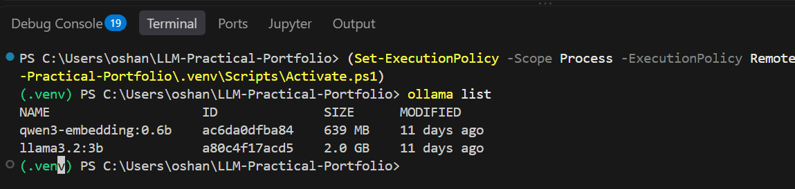

ChromaDB installed:

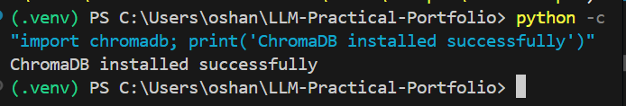

`ingest.py` storing the NSBM guide as 48 chunks:

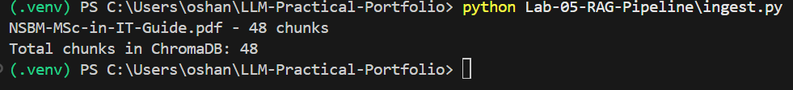

The terminal question loop:

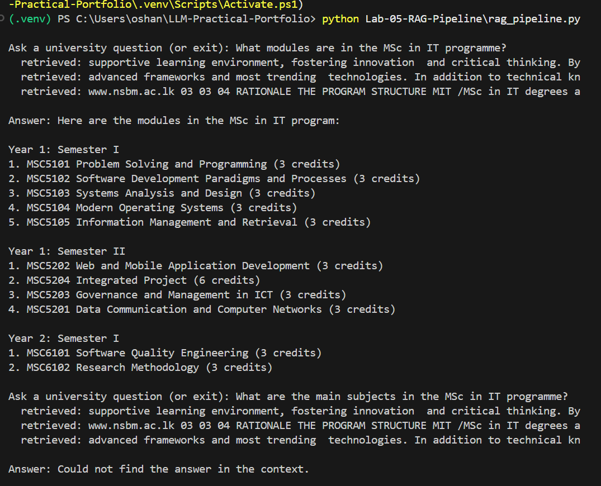

The Streamlit app answering from the guide:

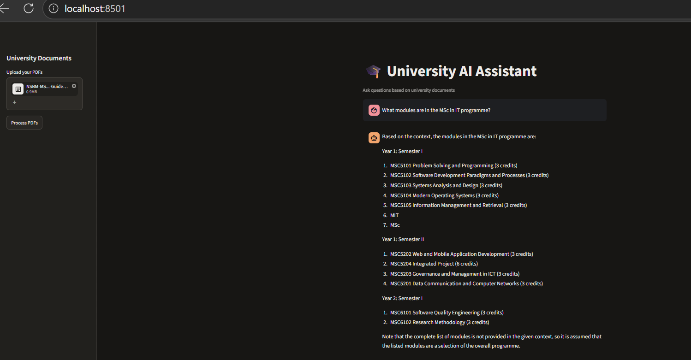

Two lab sheets uploaded and processed (13 chunks):

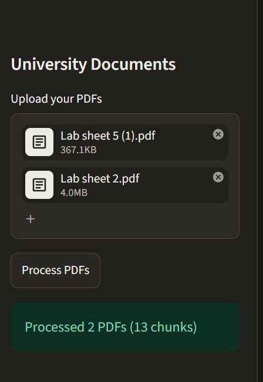

An answer that could only come from the uploaded Lab 5 sheet:

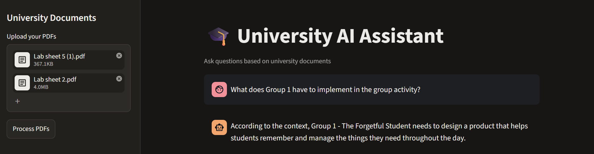

## Observations

1. One word changed the answer. "What are the main subjects in the MSc in IT programme?" and "What modules are in the MSc in IT programme?" retrieved the same three chunks, and one of them held the module table. The model listed the modules for the second question and said it couldn't find the answer for the first. The guide never uses the word "subjects", and a 3B model didn't connect the two.
2. Chunking cut the module list short. The guide lists 15 modules, but the answers stopped at 11, at MSC6102 Research Methodology. When I split the guide the same way `ingest.py` does, the table is cut across two chunks and the first one ends exactly at MSC6102. The missing four modules were in the second chunk, which wasn't retrieved. In the app the model even said the full list wasn't in its context. Taking 5 chunks instead of 3 didn't fix it: in the group evaluation, fixed-size chunks with the top 5 still gave only 11 of the 15 module codes. This problem became the topic of the group activity.
3. The module table lost its structure. It has a Pathway column (MIT / MSc), which became separate lines after text extraction. The model then listed "MIT" and "MSc" as if they were modules.
4. Some letters in the PDF come out broken. The guide's fonts draw "ft" and "ti" as special glyphs, so `pypdf` reads "So�ware" and "Opera�ng". PyMuPDF breaks the same words differently. The model still wrote the words correctly in its answers.
5. Mixing guide and upload chunks confused the model. At first every question got 5 chunks from the guide plus 5 from the uploads. "What does Group 1 have to implement in the group activity?" failed even though the answer was in the uploaded lab sheet. After I changed the app to rank all chunks together and keep the closest 5, it answered correctly.
6. The relevance check turned down a question it should have accepted. With the wording "...in lab sheet 5?", the YES/NO check said NO twice and the app refused, although the answer was in the upload. A 3B model isn't a reliable judge of relevance.
7. Windows locked the database files. `Remove-Item` couldn't delete `chroma_db` while `rag_pipeline.py` was still running in another terminal, because the script keeps `chroma.sqlite3` open. Stopping all terminals fixed it.
8. On my laptop's CPU an answer took about 20 to 35 seconds (median 29 seconds in the group evaluation, which used the same models).

## Learning outcomes

- I can build the whole RAG flow myself: load a PDF, chunk it, embed it, store it, retrieve for a question, and generate an answer from that context.
- I learned that the question and the chunks must go through the same embedding model, or the search returns unrelated text.
- I saw how chunk size and the number of retrieved chunks decide what the model can see. The cut-off module list showed me that a correct answer depends on retrieval as much as on the model.
- I learned to debug retrieval by printing the chunks the search returned, which is how I found the subjects/modules and the split-table problems.
- I can run local models with Ollama and build a Streamlit chat app with file uploads and chat history.
- A "use only the context" prompt stopped the model from making up answers, but it also made it refuse when the question used different words from the document.
- Comparing three chunking methods in the group activity showed me that the best chunking depends on how the document is laid out. Whole pages kept the module table together, while cutting at headings split it into single modules.

## Group activity: context-aware RAG (Group 2)

### Task

Group 2's task on the lab sheet is context-aware and hierarchical RAG: compare fixed-size chunking, section-based chunking and parent-child retrieval, and find which works best for a long academic handbook.

I tested the three methods on the NSBM MSc in IT programme guide (16 pages). In my individual Lab 5 work the module table in this guide was split across two fixed-size chunks, so answers listed only 11 of the 15 modules. This activity checks whether chunking that follows the document's structure fixes that.

### Architecture

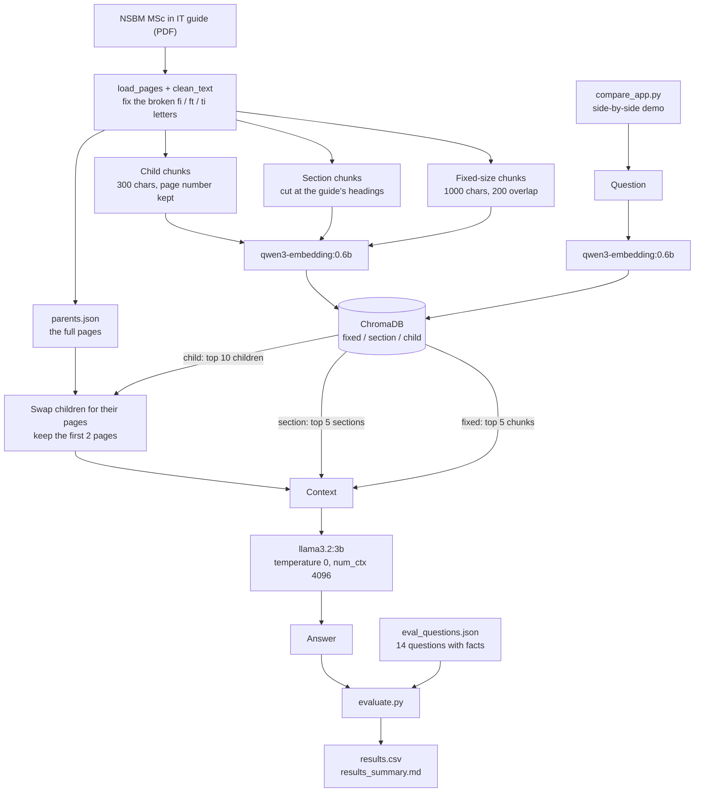

The top half runs once (`build_collections.py`). The bottom half runs for every question (`rag.py`). Only the context changes between the three methods; the embedding model, the prompt and the answer model are the same, so the comparison is fair.

### The three methods

| Method | How the guide is cut | What the model gets |
|---|---|---|
| Fixed-size (baseline) | Every 1000 characters, 200 overlap, as in the individual lab | The 5 closest chunks |
| Section-based | At the guide's headings: all-capital lines such as `ELIGIBILITY FOR THE PROGRAM`, and module codes such as `MSC5101:`. Sections over 2500 characters are split, and each piece keeps its title | The 5 closest sections |
| Parent-child | 300-character child chunks that remember their page | The 10 closest children are swapped for the pages they came from, and the first 2 pages are sent |

All three use the same cleaned text. The guide's fonts break "fi", "ft" and "ti" (for example "So�ware"), so `clean_text` in `chunking.py` repairs them before chunking.

### Files

All in the `group-activity` folder:

- `chunking.py`: loads and cleans the guide, and makes the three kinds of chunks.
- `build_collections.py`: embeds the chunks with `qwen3-embedding:0.6b` and stores them in three ChromaDB collections (fixed: 48, section: 58, child: 154). It also saves the 15 full pages to `parents.json`.
- `eval_questions.json`: the evaluation dataset.
- `rag.py`: `retrieve()` for each method, and `answer()` with `llama3.2:3b`. Temperature is 0 so a question always gets the same answer, and `num_ctx` is 4096 because two full pages can be longer than Ollama's default window.
- `evaluate.py`: runs every question through every method and writes `results.csv` and `results_summary.md`.
- `compare_app.py`: a Streamlit demo that shows the three answers side by side.

### Setup and how to run

Same environment as the individual lab (`.venv`, Python 3.14.6, Ollama with `llama3.2:3b` and `qwen3-embedding:0.6b`). Nothing extra to install. Run from the repository's top folder:

```powershell
python Lab-05-RAG-Pipeline\group-activity\build_collections.py
python Lab-05-RAG-Pipeline\group-activity\evaluate.py
streamlit run Lab-05-RAG-Pipeline\group-activity\compare_app.py
```

`chroma_db/` and `parents.json` are created by the build script and are not in the repository.

### Evaluation dataset

`eval_questions.json` has 14 questions about the guide. Each one has a reference answer, the page the answer is on, and the facts a correct answer must contain, for example `"2.30"` for the pass grade point. Some facts accept more than one spelling (`"12 months"` or `"twelve months"`). I checked that every fact appears on the page its question cites.

Most questions ask for one fact. Question 1 (list all 15 modules) and question 4 (how the 60 credits are split) need longer or spread-out answers.

### Metrics

- Context recall: the share of a question's facts found in the text sent to the model. It measures retrieval.
- Answer score: the share of the facts found in the model's answer.
- Seconds: time from the question to the finished answer.
- Context characters: how much text the model had to read.

Line breaks and extra spaces are ignored when matching, because the PDF breaks lines in the middle of phrases.

### Results

From `results_summary.md`, 14 questions per method, one run on my laptop's CPU:

| Method | Context recall | Answer score | Avg seconds | Median seconds | Avg context chars |
|---|---|---|---|---|---|
| Fixed-size (baseline) | 0.98 | 0.94 | 33.3 | 29.4 | 4766 |
| Section-based | 0.94 | 0.91 | 38.9 | 33.0 | 5587 |
| Parent-child | 0.96 | 0.96 | 102.6 | 31.6 | 7131 |

Parent-child's average time includes one run of 1032 seconds (question 5). I don't know what caused it; every other answer took under 92 seconds. Without it, parent-child averaged 31.1 seconds, so the median is the fairer number for speed.

Per-question scores are in `group-activity/results.csv`.

### Findings

1. Parent-child gave the best answers (0.96). It was the only method that got the whole module list into the context: all 15 codes for question 1. Its answer listed 14 and left out MSC6201 Research Project.
2. Section-based came last (0.91), mostly because of question 1, where only 3 of the 15 codes reached the model. Every module has its own short description section in the guide, so the search returned single-module sections and not the section with the table.
3. Fixed-size found 11 of the 15 modules, the same cut-off as in the individual lab, because the table is split across two chunks.
4. On the 10 single-fact questions all three methods scored 1.00. The methods only differed when an answer was long or spread out.
5. Parent-child sends about 50% more text than fixed-size (7131 against 4766 characters), but by the median it was no slower.
6. Parent-child is limited to 2 pages. For question 11 (the Research Project) the right page wasn't among the two, and the context recall dropped to 0.50.

For this guide, parent-child retrieval worked best, because a full page keeps tables and lists together. Section-based chunking depends on how the document's headings line up with the questions: here the module descriptions had headings, but the table didn't have its own.

### Demo

`compare_app.py` takes one question and shows the three methods' answers side by side, with the time and the amount of context for each. "What the model was given" opens the exact chunks, which shows why a method got an answer right or wrong. For the module list question the demo gave the same pattern as the evaluation: fixed-size 11 modules, section-based 3, parent-child 14.

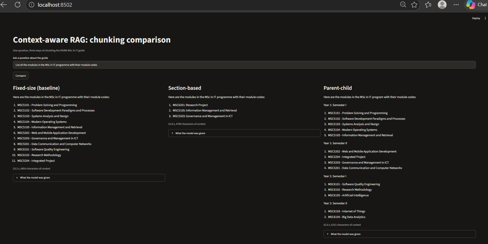

### Limitations

- 14 questions from one document, and each method ran once.
- The score only checks whether a fact's words appear. It doesn't catch wrong extra information, and a correct answer worded differently can lose points.
- Timings come from one laptop CPU, with one unexplained 17-minute run.
- Parent-child sends at most 2 pages, so an answer spread over three or more pages can be missed.
- The heading rule in `is_heading` is written for this guide's layout and would need changing for other documents.

### Screenshots

Building the three collections:

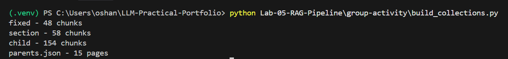

Per-question scores and the summary table:

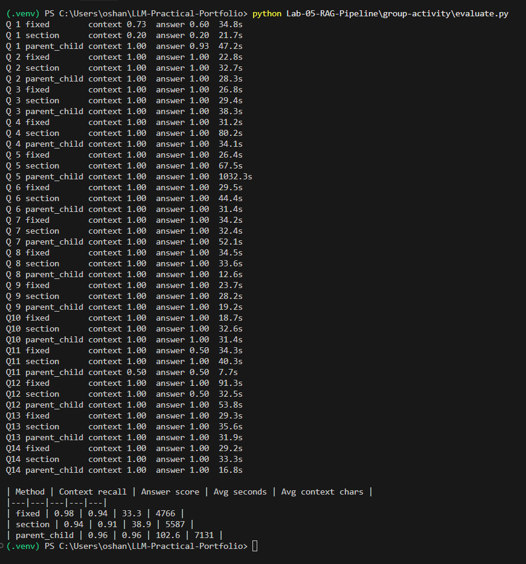
