# Lab 06: Tool-using AI agent with Ollama

## Laboratory session

Lab 06, AI agents.
I built an agent on a local model that decides when to call Python functions (tools), and added to it part by part, following parts A to D of the lab sheet: tools that work with Windows apps, memory, my Lab 5 RAG as a search tool, and Google Calendar. Part E (n8n) and the final exercise are not part of this entry.

## Objective

Build a tool-using agent on my laptop:

- `llama3.2:3b` in Ollama chooses the tools and writes the answers. LangChain (`langchain-ollama`) connects it to the Python tools.
- Part A: tools that do things on Windows (Calculator, Notepad, files, system information).
- Part B: memory, with SQLite for facts that survive a restart.
- Part C: a tool that searches the NSBM MSc in IT guide through the Lab 5 RAG.
- Part D: tools that read and add Google Calendar events.

## Tasks and implementation

### Setup

I used the same `.venv` (Python 3.14.6) and the same Ollama models as Lab 5 (`llama3.2:3b` and `qwen3-embedding:0.6b`).

```powershell
pip install langchain langchain-ollama pyautogui pygetwindow psutil
pip install google-api-python-client google-auth-httplib2 google-auth-oauthlib
pip freeze | Out-File -Encoding utf8 Lab-06-AI-Agents\requirements.txt
```

Part C also uses `chromadb` and `ollama`, which were already installed for Lab 5.

### How to run

Run from the repository's top folder:

```powershell
python Lab-06-AI-Agents\calculator_agent.py
python Lab-06-AI-Agents\multi_tool_agent.py
python Lab-06-AI-Agents\memory_agent.py
python Lab-06-AI-Agents\rag_agent.py
python Lab-06-AI-Agents\calendar_agent.py
```

Type `exit` to stop any of them. `rag_agent.py` and `calendar_agent.py` read `Lab-05-RAG-Pipeline/chroma_db`, so Lab 5's `ingest.py` has to be run first. `calendar_agent.py` also needs `credentials.json` from Google Cloud (see Part D).

### How the agents work

All five agents use the same loop:

1. Each tool is a Python function with LangChain's `@tool` decorator. The model reads the tool's docstring to decide when to use it.
2. `llm.bind_tools(tools)` sends the tool names and descriptions to `llama3.2:3b` along with the message.
3. The model either answers straight away or returns `tool_calls`: which tool to run and with what arguments.
4. My code runs the tool, prints `[TOOL SELECTED]`, `[TOOL ARGUMENTS]` and `[TOOL RESULT]`, and the model writes the answer from the result.

In Part A the result goes back to the model as a `ToolMessage`, and a second call without tools writes the answer. From Part B on, the answer is written from a normal prompt with the tool results pasted in, the same way the Lab 5 RAG answers from chunks. Observation 6 explains why I changed it.

This is the final agent from Part D, which has everything from the earlier parts:

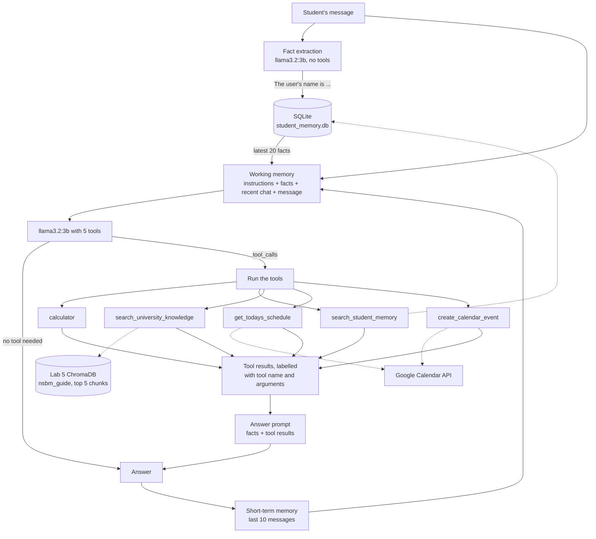

### Part A: calculator_agent.py

The lab sheet's first agent, with one tool, `open_calculator`. It opens Windows Calculator with `subprocess`, brings the window to the front with `pygetwindow`, types the expression with `pyautogui`, and returns the answer to the model.

- The expression is checked before `eval`, so only digits and `+ - * / ( ) .` get through. The model sometimes writes × or ÷, so those are replaced first.
- `pygetwindow`'s `activate()` raises "Error code from Windows: 0" even when it worked, so that exception is caught.
- There's no memory yet: every question starts a new conversation.

### Part A exercise: multi_tool_agent.py

Six tools for the lab sheet's six test queries:

| Tool | What it does |
|---|---|
| `open_calculator` | Same as in `calculator_agent.py` |
| `get_date_time` | Today's date and time from `datetime` |
| `open_notepad` | Opens Notepad and types the text |
| `search_files` | Finds files by extension or by name in a folder and its subfolders (`glob` with `**`), and returns the total and the first 10 paths |
| `create_file` | Writes a text file, and refuses if the file already exists |
| `get_system_info` | Windows version, processor, CPU cores and memory from `platform` and `psutil` |

The tools are also listed in the system prompt. If the model asks for a tool that doesn't exist, or calls one with the wrong arguments, the agent tells the model instead of crashing.

### Part B: memory_agent.py

The lab sheet's banner names three kinds of memory, and the agent has all three:

- **Short-term memory** is `chat_history`, the last 10 messages of this conversation. It's lost when the program closes.
- **Long-term memory** is a SQLite file, `student_memory.db`, with a `memories` table (`id`, `fact`, `saved_at`). Before every answer, a separate call to the model picks facts out of the message, such as "The user's name is Oshani.". The prompt has examples showing that a question gives `NONE`, only lines starting with "The user" are saved, and a fact that is already stored isn't saved again.
- **Working memory** is what the model gets for one turn: the instructions, the latest 20 facts from SQLite, the recent chat, the new message and any tool results. It's built again every turn.

The two tools are `calculator`, which works out the answer without opening the Calculator app, and `search_student_memory`. The search looks for facts containing words from the query (`LIKE`). If nothing matches it returns all saved facts, because a word search for "study" doesn't find "studies".

The database is in `.gitignore`, since it holds personal facts.

### Part C: rag_agent.py

The Part B agent plus `search_university_knowledge`, following the lab sheet's hint to use the Lab 5 RAG:

- It opens Lab 5's ChromaDB collection `nsbm_guide`: 48 chunks of the NSBM MSc in IT guide, each 1000 characters with a 200-character overlap.
- It embeds the query with `qwen3-embedding:0.6b`, the same model `ingest.py` used for the chunks, and returns the 5 closest chunks with their source file.
- It prints `[EXECUTING] Searching university knowledge for: ...` like the example on the lab sheet. A result is about 5000 characters, so the terminal shows only the first 500. The model gets all of it.
- The answer prompt tells the model to use only the information it's given and to say when it can't find the answer.
- `num_ctx=4096` leaves room for 5 chunks plus the memory and the chat.

It uses the same `student_memory.db` as Part B, so it still knew my name.

### Part D: calendar_agent.py

The Part C agent plus two Google Calendar tools:

- `get_todays_schedule` lists today's events, from midnight to midnight in Sri Lanka time (`Asia/Colombo`).
- `create_calendar_event` takes a title, a date (`YYYY-MM-DD`) and start and end times (`HH:MM`). It checks the format, and that the event ends after it starts, before calling the API.
- Today's date is in the system prompt, because the model has no other way to know what "today" means.

The lab sheet says to get an API key, but an API key only reaches public data. Reading and adding events in my own calendar needs me to sign in, so I set up OAuth:

1. I created a Google Cloud project, `LLM lab 6`, and enabled the Google Calendar API. Google Cloud wouldn't open until I turned on 2-step verification for my account.
2. In Google Auth Platform, I set up the app "Lab 6 Agent" with audience External, and added my Gmail as a test user.
3. I created an OAuth client of type Desktop app and saved its JSON file as `credentials.json`.

The first run opens the browser to sign in and saves `token.json`, so later runs don't ask again. The scope is `calendar.events`, which can read and add events. `credentials.json` and `token.json` are in `.gitignore` and are not in this repository.

## Results and evidence

Screenshots 11 to 13, 16 and 17 were taken before later fixes to how the final answer is written (observations 6 and 8). The memory and tool lines they show are the same with the final code.

### Part A

Both models in Ollama:

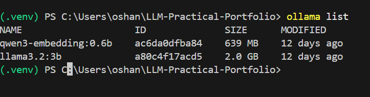

The calculator agent choosing `open_calculator` for "Calculate 25 * 3", and the result typed into Windows Calculator:

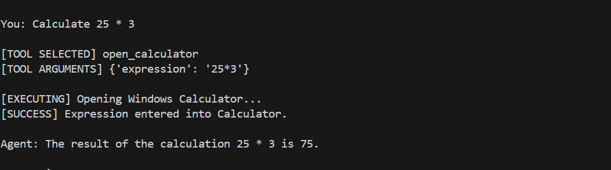

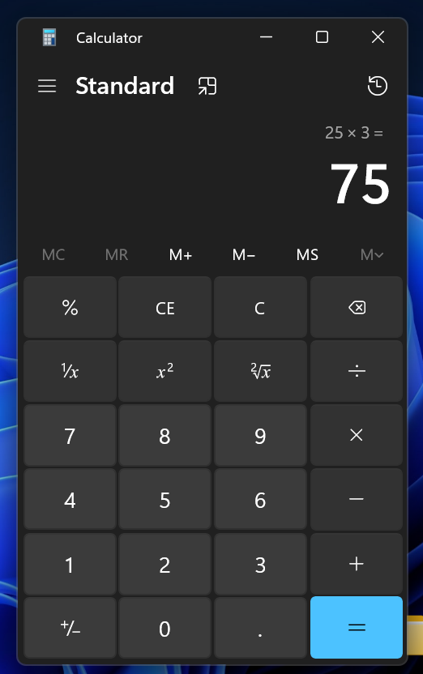

The six test queries:

| # | Query | Tool chosen | Result |
|---|---|---|---|
| 1 | Calculate 25 × 4 | `open_calculator` (`25*4`) | 100, also typed into Calculator |
| 2 | What is the date today? | `get_date_time` | Thursday, 26 November 2026 |
| 3 | Open Notepad and write Hello Students | `open_notepad` | Notepad opened with the text |
| 4 | Find all PDF files in `...\Lab-05-RAG-Pipeline\data` | `search_files` | 1 file, `NSBM-MSc-in-IT-Guide.pdf` |
| 5 | Create a file called test.txt in `C:\Users\oshan\Documents` with Hello World | `create_file` | File created |
| 6 | Show my computer specifications | `get_system_info` | Windows 11, 10 cores (12 logical), 15.7 GB memory |

The agent chose the right tool for all six.


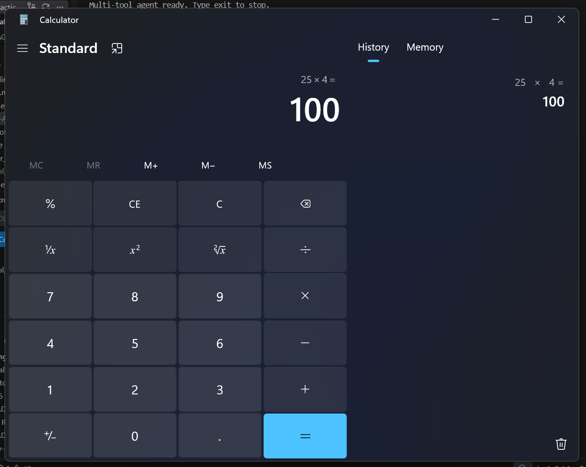

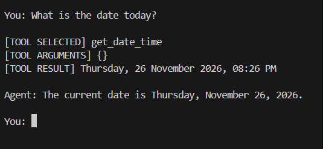

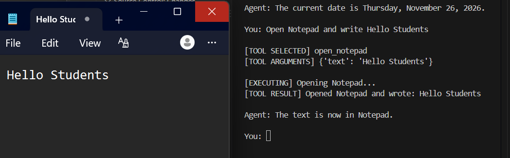

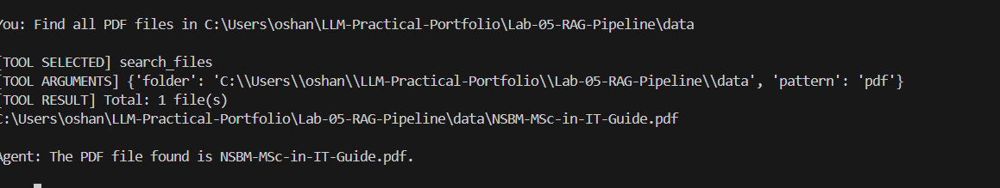

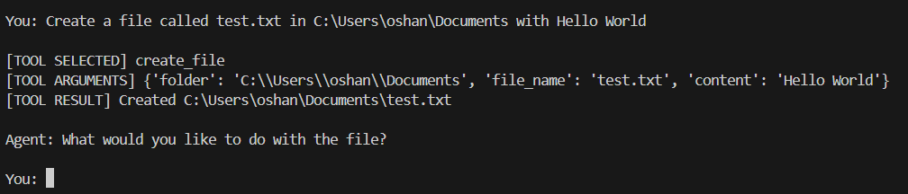

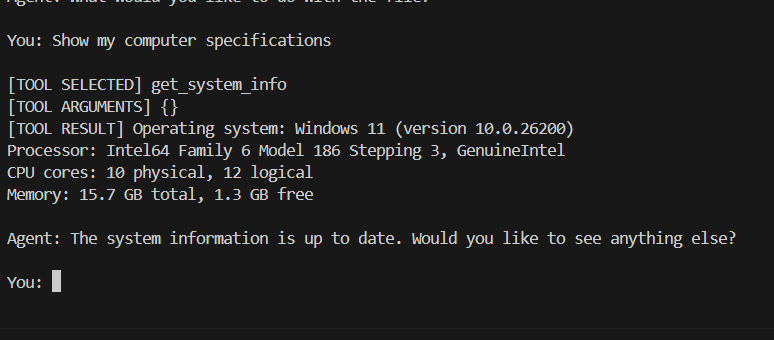

The file from query 5:

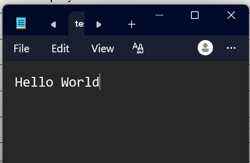

### Part B

| Message | What happened |
|---|---|
| My name is Oshani and I study Data science at NSBM | Two facts saved to SQLite |
| What is my name? | Nothing saved; `search_student_memory` found the name; "Your name is Oshani." |
| What is 15 × 12? | `calculator`, 180 |
| *(program closed and started again)* What is my name? | Short-term memory empty; the search found the name in SQLite; "Your name is Oshani." |
| What do I study? | "You study Data Science at NSBM." |

Saving facts from the first message:

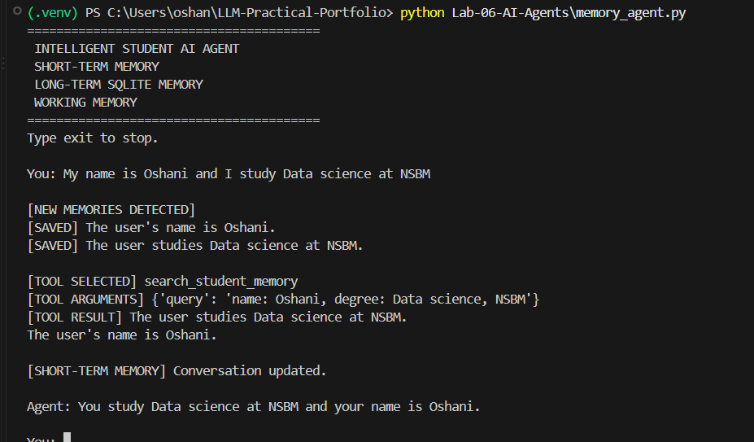

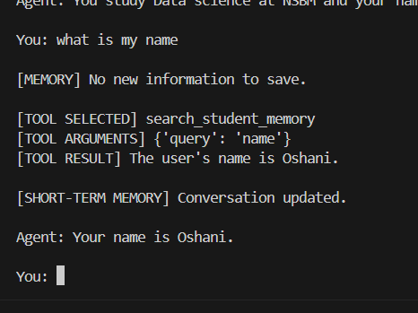

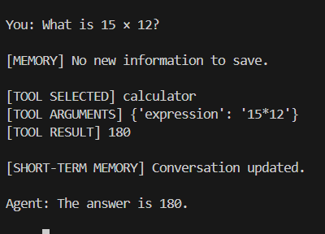

After a restart:

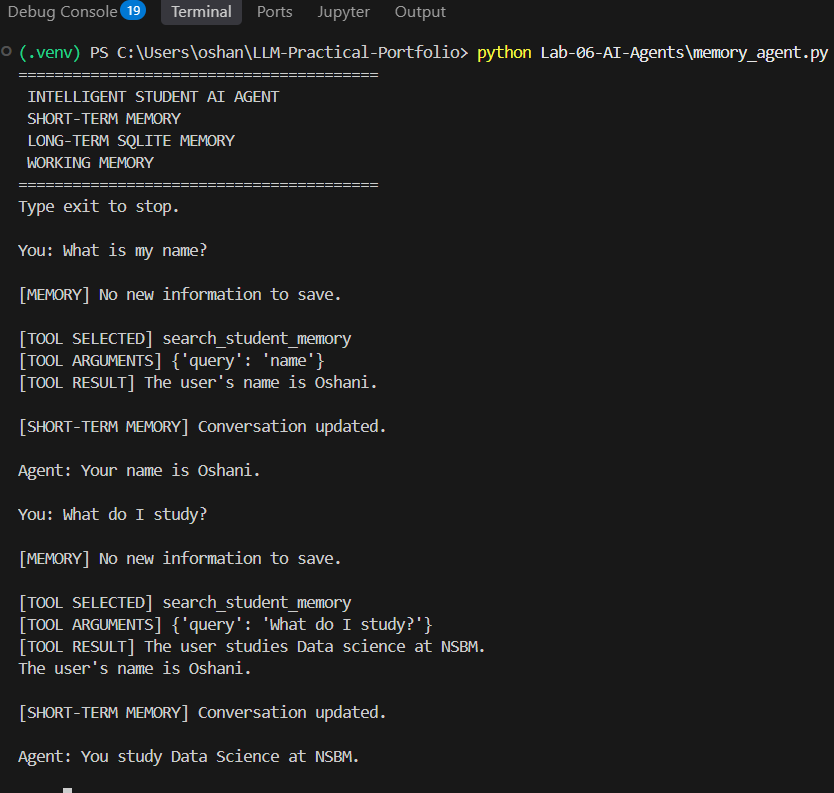

The `memories` table in SQLite:

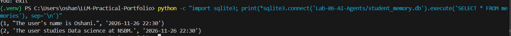

### Part C

| Message | Tool chosen | Answer |
|---|---|---|
| Does NSBM refund the fees paid for the programme? | `search_university_knowledge` | No, except when the programme isn't run because too few students register (rule 7(i) in the guide) |
| What is my name? | `search_student_memory` | Oshani, from the Part B memory |
| What is 60 - 39? | `calculator` | 21 |
| What is the medium of instruction for the MSc in IT programme? | `search_university_knowledge` | Couldn't find it (observation 7) |

The printed result in the first screenshot shows the cover page, because it is the first of the 5 chunks and the terminal cuts the result at 500 characters. The chunk with the refund rule was in the rest.

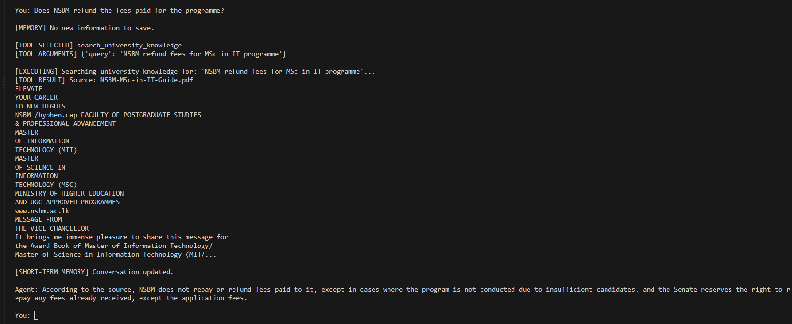

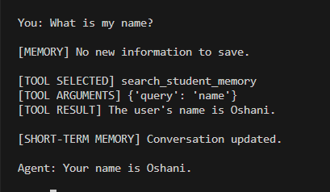

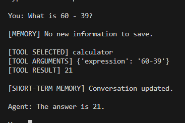

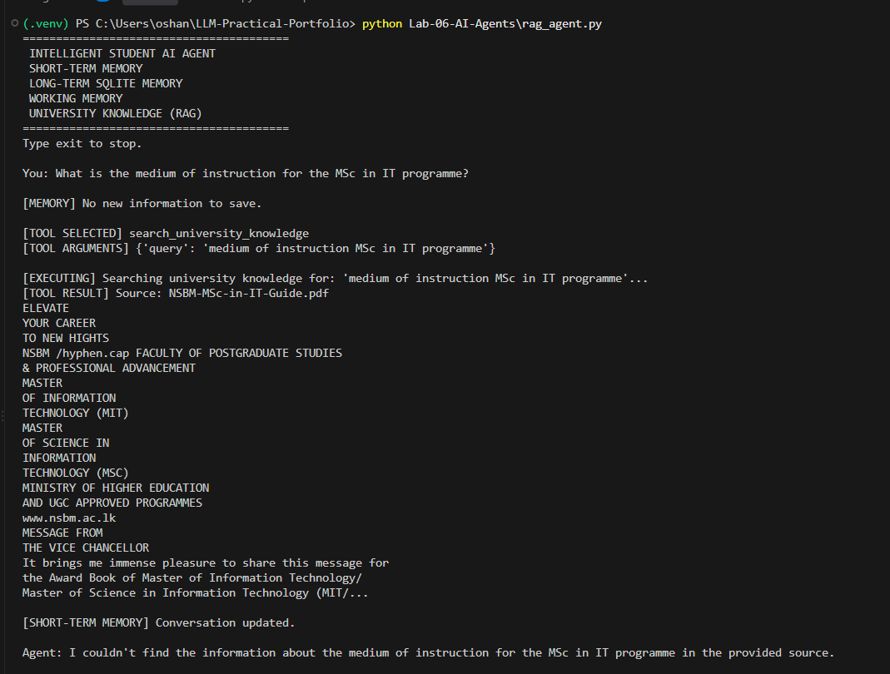

### Part D

| Message | Tool chosen | Result |
|---|---|---|
| Add an event called Lab 6 viva practice today from 17:00 to 18:00 | `create_calendar_event` | Event added |
| What is on my schedule today? | `get_todays_schedule` | 15:00 - 16:00 LLM revision, 17:00 - 18:00 Lab 6 viva practice |

The Calendar API enabled in the `LLM lab 6` project:

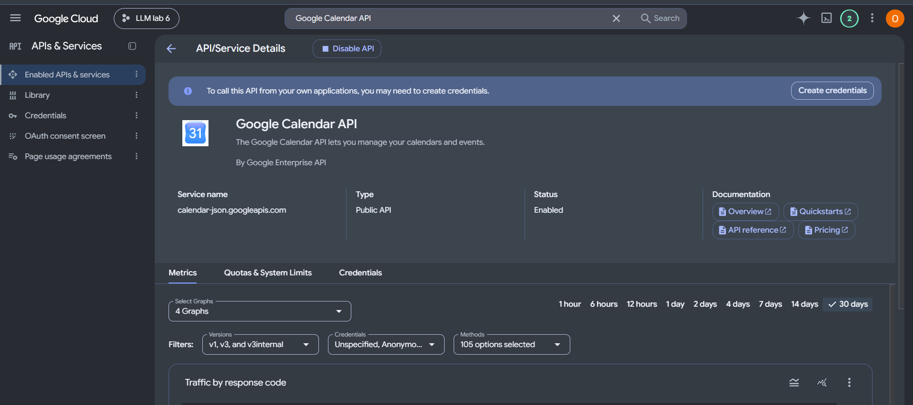

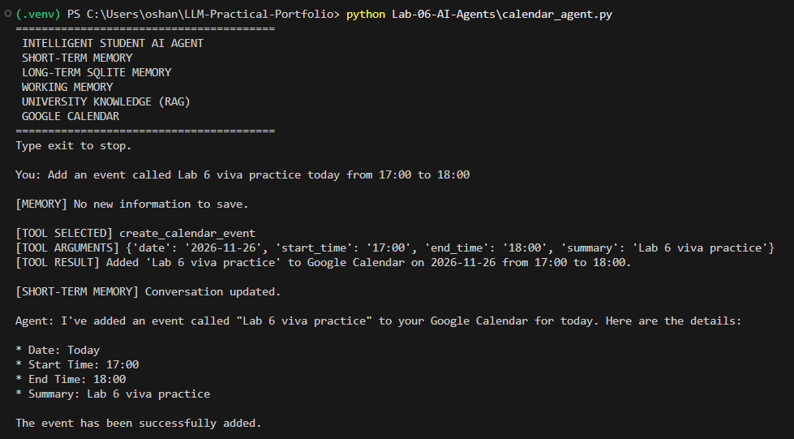

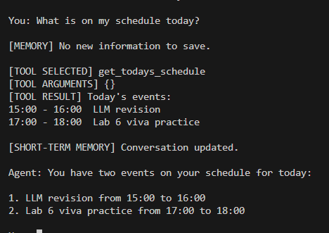

Both events in Google Calendar. My calendar was still set to GMT when I took this, so 15:00 and 17:00 Sri Lanka time show as 9:30 and 11:30 (observation 9):

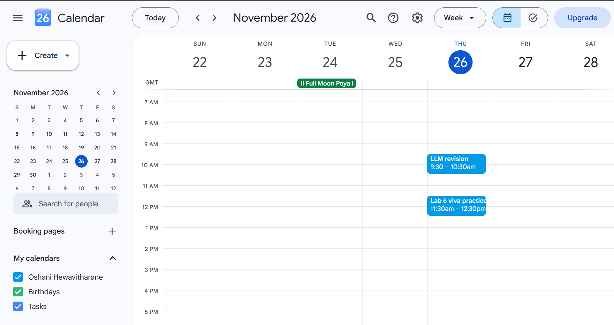

## Observations

1. Choosing the tool was the strong part; the replies after it were weaker. All six Part A queries picked the right tool, but after creating `test.txt` the agent asked "What would you like to do with the file?", and it called my computer's specifications "up to date".
2. The model read a number out of a file name. My first search of the Downloads folder found 445 PDFs, but the agent said 123, the name of one of the files (`123.pdf`). I put the total on its own line, sent only the first 10 names, and told the model to use numbers exactly as the tool gives them. I also moved query 4 to the Lab 5 data folder, because the Downloads list showed private file names and this repository is public.
3. The first `search_files` treated a short name such as "NSBM" as a file extension. It now checks against a fixed list of extensions.
4. The memory step saved its own answers as memories. For "What is my name?", the extraction call answered the question and saved "I don't have any information about your name." as a fact. Then the search found that sentence, and the agent said it didn't know my name. The rule "a question is not a fact" in the prompt didn't stop it. Examples in the prompt (questions give `NONE`) and keeping only lines that start with "The user" did.
5. Short-term memory covered for broken long-term memory. In the same session the agent still answered "You told me your name is Oshani" from the chat history. Only after a restart, when nothing but SQLite was left, did the problem show.
6. After a restart, the search returned "The user's name is Oshani", but the agent answered "I don't know yet". Explaining in the prompt that "the user" means the student didn't change the answer. Sending the result as "Your name is Oshani." made it worse: it said it had no information about a student named Oshani and printed a tool call as plain text. With the facts added to the prompt it answered with my degree instead of my name. What worked was writing the final answer from a normal prompt with the tool results pasted in, like the Lab 5 RAG, instead of sending them back as tool messages.
7. The search query decided what the RAG could find. "What is the medium of instruction for the MSc in IT programme?" failed with 3 chunks and again with 5. The model searched for "medium of instruction MSc in IT programme", and the cover page, which repeats the programme's name, came first. The answer is in chunk 33 ("The mode of instruction of the Program shall be in English medium"). I think the programme's name in the query pulled the search towards the cover page. The agent said it couldn't find the answer instead of guessing. The refund question worked; "refund" and "fees" appear in two chunks, which probably helped.
8. "Use only the information below" also blocked correct answers. The calculator returned 21, and the agent said it couldn't find the result, because all it got was a bare number. Labelling each result with the tool's name and arguments fixed it. The same prompt made the agent say it couldn't add calendar events right after it had added one, until the prompt also told it to say what a tool did.
9. Time zones caused two bugs in Part D. A 15:00 event came back as 09:30, because the Calendar API returns times in the account's time zone, and mine was GMT. Passing `timeZone="Asia/Colombo"` fixed the schedule tool. In the same run the agent also listed a second "LLM revision" at 15:00 that wasn't in the tool result; it took it from the chat history.
10. Some problems came from Windows and the tools around the code, not the agent. VS Code saved its open copy of `memory_agent.py` over my updated file twice, so I had to close the tab before replacing the file. `student_memory.db` couldn't be deleted while an agent still had it open. Google Cloud blocked the console until I turned on 2-step verification.

## Learning outcomes

- I can turn Python functions into tools with `@tool` and let a local model choose them with `bind_tools`. I learned that the model chooses from the docstrings, so they have to say clearly when to use each tool.
- I understand the agent loop: the model asks for a tool, my code runs it, and the result goes back to the model for the answer.
- I can build the three kinds of memory: chat history for short-term, a SQLite table for long-term facts, and the prompt built for each turn as working memory.
- I reused my Lab 5 RAG as a tool, and saw that the same retrieval problems, the query's wording and the number of chunks, carry over into an agent.
- I set up Google OAuth with a consent screen, a test user, a desktop client and a token file, and kept the keys out of Git.
- With a 3B model, choosing the tool was the easy part. Most of my fixes were about what the model sees after the tool runs.
- Tools that act on the computer or the calendar need their inputs checked (`eval`, overwriting files, dates and times), because the model's arguments can be wrong.
